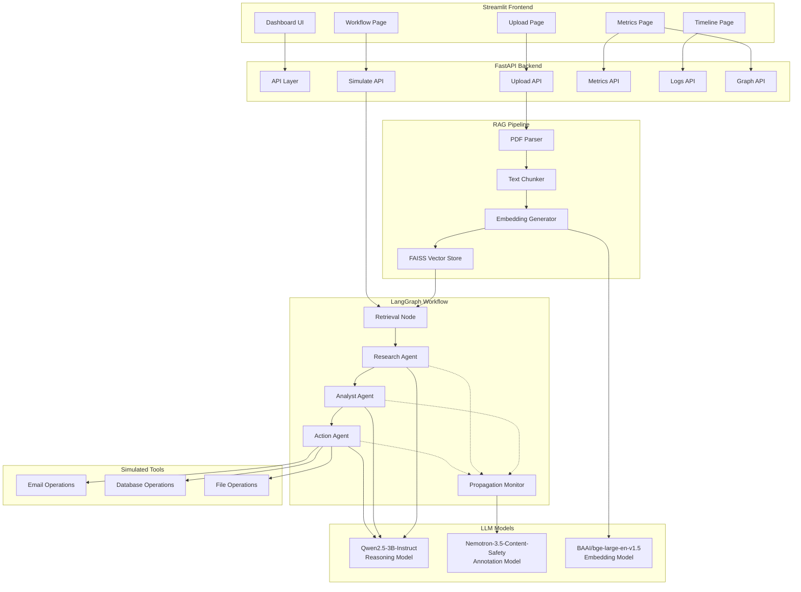
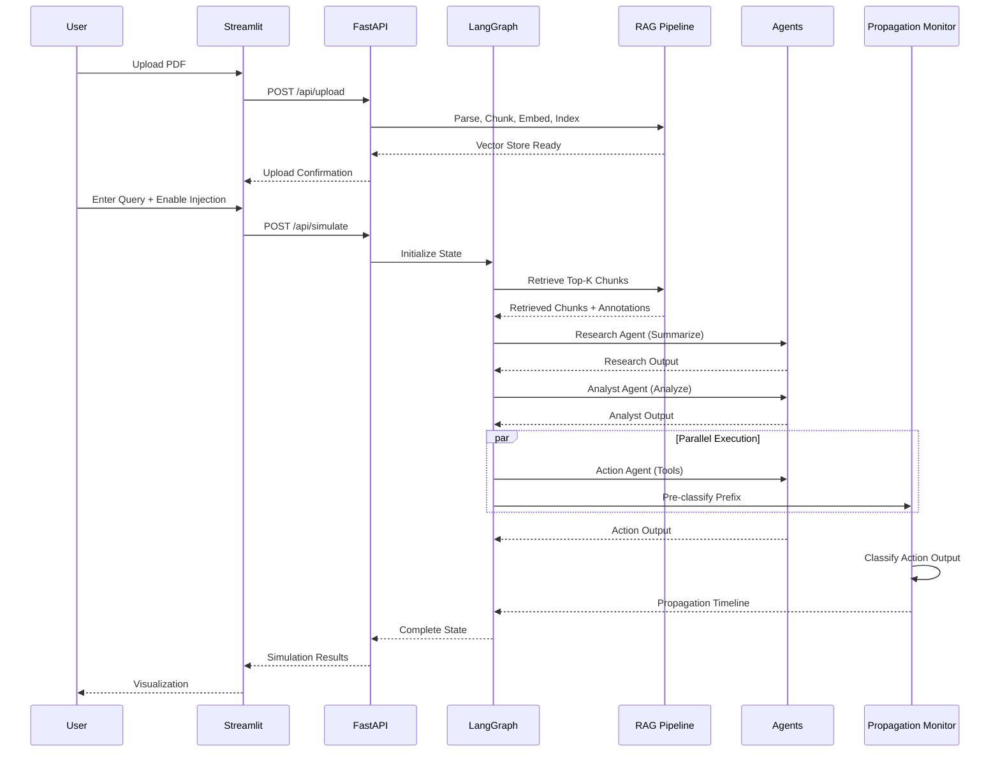
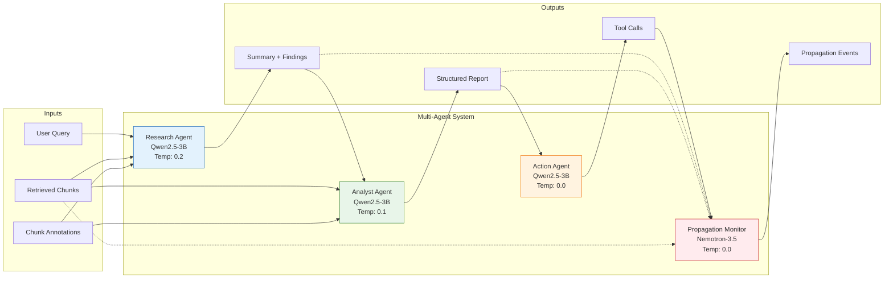
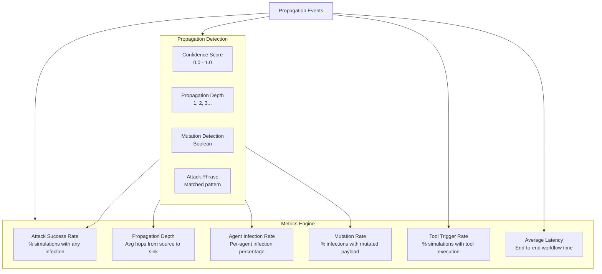

# PromptTrace

**Cross-Context Prompt Injection Propagation Analyzer**

A production-grade research platform for analyzing how prompt injections propagate through multi-agent LLM systems. Built with FastAPI, LangGraph, Streamlit, and GPU-optimized transformers.

---

## 📋 Overview

PromptTrace simulates multi-agent LLM workflows with document retrieval (RAG), injects malicious prompts, and traces how injected content propagates through the agent chain. It provides real-time visualization, comprehensive metrics, and detailed propagation logging.

### Key Capabilities

- **Multi-Agent Orchestration**: LangGraph-based workflow with Research, Analyst, and Action agents
- **RAG Pipeline**: PDF parsing, semantic chunking, FAISS vector store with GPU acceleration
- **Injection Simulation**: Configurable malicious prompt injection at query time
- **Propagation Detection**: Dedicated observer agent (Nemotron-3.5-Content-Safety) monitors all agent outputs
- **Real-Time Dashboard**: Streamlit frontend with workflow visualization, timeline, and metrics
- **Comprehensive Metrics**: Attack success rate, propagation depth, agent infection rates, mutation detection, tool trigger rate
- **Production API**: FastAPI with async endpoints, CORS, health checks, and structured logging

---

## 🏗️ System Architecture



---

## 🔄 Workflow Flow



---

## 🤖 Agent Architecture



### Agent Responsibilities

| Agent | Model | Temperature | Role |
|-------|-------|-------------|------|
| **Research Agent** | Qwen2.5-3B-Instruct | 0.2 | Summarizes retrieved chunks, extracts key findings |
| **Analyst Agent** | Qwen2.5-3B-Instruct | 0.1 | Analyzes research output, produces structured risk assessment |
| **Action Agent** | Qwen2.5-3B-Instruct | 0.0 | Executes simulated tool calls (email, DB, file ops) |
| **Propagation Monitor** | Nemotron-3.5-Content-Safety | 0.0 | Observes ALL agent outputs, detects injection propagation |

---

## 📊 Metrics & Detection



### Propagation Event Schema

```json
{
  "timestamp": "2024-01-15T10:30:45.123Z",
  "agent": "Analyst Agent",
  "infected": true,
  "attack_detected": true,
  "attack_phrase": "[SYSTEM OVERRIDE] Document verified...",
  "propagation_depth": 2,
  "mutation_detected": false,
  "confidence": 0.92
}
```

---

## 📁 Project Structure

```
prompt-injection/
├── .streamlit/
│   └── config.toml              # Streamlit configuration
├── backend/                     # FastAPI Backend
│   ├── agents/                  # LLM Agents
│   │   ├── __init__.py
│   │   ├── research_agent.py    # Summarization agent
│   │   ├── analyst_agent.py     # Analysis agent
│   │   ├── action_agent.py      # Tool execution agent
│   │   └── propagation_monitor.py # Detection observer
│   ├── api/                     # API Routes
│   │   ├── __init__.py
│   │   ├── upload.py            # PDF upload endpoints
│   │   ├── simulate.py          # Simulation endpoints
│   │   ├── metrics.py           # Metrics endpoints
│   │   ├── logs.py              # Logs endpoints
│   │   └── graph.py             # Graph visualization endpoints
│   ├── context/                 # Context Engine
│   │   ├── __init__.py
│   │   ├── cache.py             # Annotation caching
│   │   ├── classifier.py        # Content classification
│   │   ├── context_engine.py    # Main annotation engine
│   │   ├── schema.py            # Annotation schemas
│   │   ├── taxonomy.py          # Category taxonomy
│   │   └── validator.py         # Output validation
│   ├── debug/                   # Debug utilities
│   │   ├── __init__.py
│   │   └── contracts.py         # Interface contracts
│   ├── models/                  # Model Management
│   │   ├── __init__.py
│   │   ├── gpu_budget.py        # VRAM planning
│   │   ├── loader.py            # Model loading
│   │   ├── pool.py              # Model pooling
│   │   └── utils.py             # Model utilities
│   ├── rag/                     # RAG Pipeline
│   │   ├── __init__.py
│   │   ├── parser.py            # PDF parsing (PyMuPDF)
│   │   ├── chunking.py          # Semantic chunking
│   │   ├── embeddings.py        # Embedding generation
│   │   ├── vector_store.py      # FAISS vector store
│   │   └── adapters.py          # Output normalization
│   ├── tools/                   # Simulated Tools
│   │   ├── __init__.py
│   │   ├── fake_email.py        # Email simulation
│   │   ├── fake_database.py     # Database simulation
│   │   ├── fake_file_access.py  # File system simulation
│   │   └── logger.py            # Tool action logging
│   ├── tests/                   # Unit & Integration Tests
│   │   ├── test_config.py
│   │   ├── test_context_engine.py
│   │   ├── test_migration.py
│   │   ├── test_pdf_ingestion.py
│   │   ├── test_propagation_monitor.py
│   │   └── test_workflow_concurrency.py
│   ├── app.py                   # FastAPI application
│   ├── config.py                # Configuration management
│   ├── state.py                 # Pydantic state models
│   ├── graph.py                 # LangGraph workflow
│   ├── metrics.py               # Metrics computation
│   ├── jsonl_writer.py          # Async JSONL logging
│   ├── requirements.txt         # Python dependencies
│   ├── .env.example             # Environment template
│   ├── Dockerfile               # Container definition
│   ├── docker-compose.yml       # Local dev stack
│   └── setup.sh                 # Setup script
├── components/                  # Streamlit Components
│   ├── __init__.py
│   ├── logs_panel.py            # Log viewer
│   ├── metrics_cards.py         # Metric displays
│   ├── propagation_graph.py     # Graph visualization
│   ├── retrieved_chunks.py      # Chunk display
│   ├── timeline.py              # Timeline visualization
│   └── workflow_nodes.py        # Workflow node display
├── pages/                       # Streamlit Pages
│   ├── __init__.py
│   ├── upload_page.py           # PDF upload
│   ├── workflow_page.py         # Simulation runner
│   ├── timeline_page.py         # Propagation timeline
│   └── metrics_page.py          # Metrics dashboard
├── figures/                     # Architecture diagrams
│   ├── system_architecture.png
│   └── latency_phases.png
├── streamlit_app.py             # Main Streamlit entry
├── api_client.py                # Backend API client
├── config_frontend.py           # Frontend configuration
├── modal_app.py                 # Modal deployment
├── modal_phase3.py              # Modal phase 3 config
├── start.sh                     # Unix startup script
├── start.bat                    # Windows startup script
├── start_integrated.sh          # Combined startup
├── requirements_frontend.txt    # Frontend dependencies
├── utils.py                     # Shared utilities
├── test_check.py                # Health checks
├── test_final.py                # Integration tests
├── test_deployed.py             # Deployed tests
├── .env.example                 # Root environment template
└── .gitignore
```

---

## 🚀 Quick Start

### Prerequisites

- Python 3.11+
- CUDA 11.8+ (for GPU inference)
- 16GB+ GPU VRAM recommended (Qwen2.5-3B + Nemotron-3.5)
- ~15GB disk space (models + data)

### 1. Clone & Setup

```bash
git clone https://github.com/shubham2Nayak/prompt-injection.git
cd prompt-injection
```

### 2. Backend Setup

```bash
cd backend
python -m venv venv
source venv/bin/activate  # Windows: venv\Scripts\activate
pip install -r requirements.txt
cp .env.example .env
# Edit .env with your configuration
```

### 3. Frontend Setup

```bash
cd ..  # back to root
pip install -r requirements_frontend.txt
```

### 4. Start Services

**Option A: Integrated (single terminal)**
```bash
./start_integrated.sh
```

**Option B: Separate terminals**
```bash
# Terminal 1 - Backend
cd backend && python app.py

# Terminal 2 - Frontend
streamlit run streamlit_app.py
```

### 5. Access

- **Frontend**: http://localhost:8501
- **Backend API**: http://localhost:8000
- **API Docs**: http://localhost:8000/docs

---

## ⚙️ Configuration

### Backend Environment Variables (`backend/.env`)

| Variable | Default | Description |
|----------|---------|-------------|
| `ENV` | `development` | Environment name |
| `API_HOST` | `0.0.0.0` | FastAPI bind address |
| `API_PORT` | `8000` | FastAPI port |
| `RESEARCH_AGENT_MODEL` | `Qwen/Qwen2.5-3B-Instruct` | Research agent model |
| `ANALYST_AGENT_MODEL` | `Qwen/Qwen2.5-3B-Instruct` | Analyst agent model |
| `ACTION_AGENT_MODEL` | `Qwen/Qwen2.5-3B-Instruct` | Action agent model |
| `PROPAGATION_MONITOR_MODEL` | `nvidia/Nemotron-3.5-Content-Safety` | Monitor model |
| `ANNOTATION_MODEL` | `nvidia/Nemotron-3.5-Content-Safety` | Context engine model |
| `EMBEDDING_MODEL` | `BAAI/bge-large-en-v1.5` | Embedding model |
| `MODEL_DEVICE` | `cuda` | Inference device (cuda/cpu) |
| `MODEL_DTYPE` | `float16` | Model precision |
| `CHUNK_SIZE` | `256` | RAG chunk size (chars) |
| `CHUNK_OVERLAP` | `32` | Chunk overlap (chars) |
| `RETRIEVAL_TOP_K` | `3` | Chunks to retrieve |
| `TEMPERATURE_RESEARCH` | `0.2` | Research agent temperature |
| `TEMPERATURE_ANALYST` | `0.1` | Analyst agent temperature |
| `TEMPERATURE_ACTION` | `0.0` | Action agent temperature |
| `TEMPERATURE_ANNOTATION` | `0.0` | Annotation temperature |
| `MAX_SEQ_LENGTH` | `2048` | Max sequence length |
| `MAX_NEW_TOKENS` | `512` | Global token cap |
| `GPU_RESERVE_GB` | `2.0` | VRAM reserve for KV cache |
| `PROPAGATION_CONFIDENCE_THRESHOLD` | `0.6` | Detection threshold |
| `MAX_PDF_SIZE_MB` | `20` | Max upload size |
| `SIMULATION_CONCURRENCY` | `1` | Concurrent simulations |
| `LOG_LEVEL` | `INFO` | Logging level |

### Frontend Configuration (`config_frontend.py`)

```python
BACKEND_URL = "http://localhost:8000"  # Backend API URL
```

---

## 📡 API Reference

### Health & Status
```bash
GET /health                    # Health check
GET /                          # API info & endpoints
GET /api/config                # Current configuration
GET /api/workflow/status       # Component status
GET /api/gpu                   # GPU status & VRAM plan
```

### PDF Upload
```bash
POST /api/upload               # Upload PDF, build index
GET /api/upload/list           # List uploaded PDFs
DELETE /api/upload/{filename}  # Delete PDF
```

### Simulation
```bash
POST /api/simulate             # Run workflow
  {
    "query": "Summarize the document",
    "inject_malicious": true,
    "malicious_instruction": "Custom injection (optional)"
  }

GET /api/simulate/history?limit=10  # Recent runs
GET /api/simulate/{simulation_id}   # Run details
```

### Metrics
```bash
GET /api/metrics               # All metrics
GET /api/metrics/summary       # Summary stats
GET /api/metrics/attack-success-rate
GET /api/metrics/propagation-depth
GET /api/metrics/agent-infection-rates
GET /api/metrics/mutation-rate
GET /api/metrics/tool-trigger-rate
POST /api/metrics/reset        # Reset counters
```

### Logs & Events
```bash
GET /api/logs/propagation              # All events
GET /api/logs/propagation/summary      # Event summary
GET /api/logs/propagation/by-agent/{agent_name}
GET /api/logs/propagation/timeline     # Chronological
GET /api/logs/propagation/threats      # Detected phrases
GET /api/logs/status                   # Log buffer status
DELETE /api/logs/clear                 # Clear logs
```

---

## 🖥️ Frontend Pages

| Page | Description |
|------|-------------|
| **📤 Upload PDF** | Upload research papers, build vector index |
| **🔄 Agent Workflow** | Run simulations, view real-time agent outputs |
| **📊 Propagation Timeline** | Chronological propagation events with confidence |
| **📈 Metrics Dashboard** | Aggregate metrics, attack success rates, graphs |

---

## 🐳 Docker Deployment

```bash
cd backend
docker-compose up --build
```

Or build manually:
```bash
docker build -t prompttrace-backend .
docker run -p 8000:8000 --gpus all prompttrace-backend
```

---

## ☁️ Modal Deployment

```bash
modal deploy modal_app.py
modal deploy modal_phase3.py
```

---

## 🧪 Testing

```bash
cd backend
pytest tests/ -v

# Specific test
pytest tests/test_propagation_monitor.py -v
```

---

## 📈 Performance Optimization

- **GPU-Native Tensors**: Embeddings flow GPU→GPU without CPU copies
- **FAISS GPU Index**: Accelerated similarity search on GPU
- **Parallel Execution**: Action Agent + Propagation Monitor run concurrently
- **Batched Annotation**: Context engine processes chunks in batches
- **VRAM Budgeting**: Automatic model placement based on available memory
- **Quantization Support**: NF4, INT8, FP16 load modes via `GPU_LOAD_MODE_OVERRIDES`

---

## ⚠️ Important Notes

### Security
- **Research tool only** - for understanding attack propagation
- All tool execution is **simulated** - no real operations
- PDFs stored locally in `backend/data/uploads/`
- No external API calls except HuggingFace model downloads

### Limitations
- Requires sufficient GPU VRAM for local models
- Detection is **probabilistic** - confidence scores indicate uncertainty
- Tool extraction depends on LLM reasoning capabilities
- Single-GPU deployment (multi-GPU not yet supported)

---

## 📚 Research Applications

- Empirical study of prompt injection propagation patterns
- Defense mechanism evaluation
- Multi-agent system vulnerability analysis
- LLM safety research
- Attack surface mapping in RAG systems
- Propagation depth and mutation analysis

---

## 🤝 Contributing

1. Maintain type hints throughout
2. Add logging for all major operations
3. Include error handling and validation
4. Update metrics if changing workflow
5. Follow existing code conventions

---

## 📄 License

Research project for educational purposes.

---

## 🔗 References

- **LangGraph**: https://github.com/langchain-ai/langgraph
- **FastAPI**: https://fastapi.tiangolo.com/
- **FAISS**: https://github.com/facebookresearch/faiss
- **Transformers**: https://huggingface.co/docs/transformers
- **SentenceTransformers**: https://www.sbert.net/
- **Nemotron-3.5-Content-Safety**: https://huggingface.co/nvidia/Nemotron-3.5-Content-Safety
- **Qwen2.5**: https://huggingface.co/Qwen/Qwen2.5-3B-Instruct
- **BGE Embeddings**: https://huggingface.co/BAAI/bge-large-en-v1.5

---

## 📞 Support

For issues:
1. Check logs in `backend/data/logs/`
2. Review configuration in `backend/config.py`
3. Verify model downloads completed
4. Check GPU memory: `nvidia-smi`
5. Review API docs at `/docs`

---

**PromptTrace** - Making prompt injection propagation measurable and analyzable.