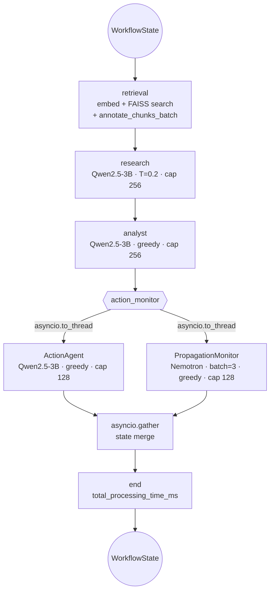

# PromptTrace — Research Source Document

**Purpose.** Exhaustive, code-grounded technical source material for a 15-page IEEE conference
paper. Every architectural claim below is traceable to a file, line range, or committed telemetry
artifact in this repository. Numbers are tagged with a **provenance class**:

| Tag | Meaning |
|---|---|
| `[M]` | **Measured** — read directly from a committed artifact (`backend/data/logs/*.jsonl`, `backend/data/logs/prompttrace.log`). |
| `[D]` | **Derived** — computed by aggregation/arithmetic over `[M]` artifacts; derivation shown. |
| `[C]` | **Code-derived** — read from source; a structural fact, not a timing measurement. |
| `[E]` | **Estimated / projected** — analytical projection; **must be replaced with an instrumented measurement before camera-ready submission.** |

> **Reviewer-facing honesty requirement.** Sections 4.1 and 4.2 mix `[M]`/`[D]` and `[E]` values.
> The `[E]` rows are explicitly marked and are listed again in the Appendix (Section 7.4) as
> *must-measure* items. Do not launder an estimate into a result.

---

## Repository Map (files cited in this document)

```
backend/
  app.py                        FastAPI entrypoint, lifespan pre-warm, router mounting
  config.py                     Centralized Config singleton + model registry + token-cap clamp
  graph.py                      PromptTraceWorkflow: LangGraph topology + node bodies
  state.py                      Pydantic WorkflowState and all agent I/O schemas
  prompts.py                    Centralized system/user prompt templates
  metrics.py                    MetricsEngine: propagation statistics
  agents/
    research_agent.py           ResearchAgent
    analyst_agent.py            AnalystAgent
    action_agent.py             ActionAgent (+ tool schema validation + alias normalization)
    propagation_monitor.py      PropagationMonitor (batched Nemotron classification)
  models/
    loader.py                   Singleton model loaders, attention-kernel selection, CUDA warmup
    pool.py                     ModelPool (thread-safe), invocation telemetry (JSONL)
    utils.py                    JSON extraction, confidence clamping, category validation
  context/
    context_engine.py           AnnotationClassifier + ContextEngine (batched + cached)
    schema.py                   ContextAnnotation / AnnotationSpan / WorkflowAnnotation
    cache.py                    SHA-256 normalized-text annotation cache (FIFO eviction)
    taxonomy.py                 5-way AnnotationCategory enum
    validator.py                Zero-retry JSON extraction/validation
    classifier.py               Thin (legacy) classifier wrapper
  rag/
    parser.py                   PyMuPDF parser, 3-tuple (text, page, paragraph_offsets)
    chunking.py                 Paragraph-preserving chunker, processing-note-aware
    embeddings.py               SentenceTransformers BGE with convert_to_tensor=True
    vector_store.py             FAISS IndexFlatL2/IP, faiss.index_cpu_to_gpu
    adapters.py                 Idempotent contract adapters (ChunkDocument/PageContent)
  api/                          upload.py, simulate.py, metrics.py, logs.py, graph.py routers
  tools/                        fake_email / fake_database / fake_file_access + PropagationLogger
  debug/contracts.py            Runtime field-level contract assertions at stage boundaries
  tests/                        test_config, test_context_engine, test_propagation_monitor,
                                test_pdf_ingestion, test_migration
frontend/
  api_client.py                 HTTP client + normalize_workflow_response() contract mapper
  pages/                        workflow_page.py, upload_page.py, timeline_page.py, metrics_page.py
  components/                   workflow_nodes, retrieved_chunks, metrics_cards, timeline,
                                propagation_graph, logs_panel
  streamlit_app.py              Session-state bootstrap, dark theme, sidebar navigation
  config_frontend.py            Frontend constants (timeouts, colors, display caps)
```

---

# Section 1 — Abstract & Core System Specifications

## 1.1 Candidate Paper Titles (IEEE style)

**T1.** *PromptTrace: Instrumenting Cross-Context Prompt-Injection Propagation in a GPU-Constrained Multi-Agent LLM Pipeline*

**T2.** *Zero-Copy Retrieval and Single-Pass Batched Safety Classification for Real-Time Adversarial-Instruction Propagation Analysis on a Single NVIDIA T4*

**T3.** *A Contract-Verified LangGraph Architecture for Measuring Adversarial Instruction Persistence Across Heterogeneous LLM Agent Boundaries*

---

## 1.2 Executive Abstract

> **PromptTrace** measures cross-context prompt-injection propagation in multi-agent LLM systems.
> A malicious instruction embedded in a retrieved document is not consumed once: every downstream
> agent re-serializes it, and each re-serialization is an opportunity for the payload to persist
> or mutate. Existing agent frameworks observe only single-turn input/output and provide no
> instrumentation for this transitive effect. We present a LangGraph pipeline in which a semantic
> `Retrieval` node feeds a `Research` -> `Analyst` -> `Action` chain, with a `PropagationMonitor`
> observing every agent boundary via a dedicated content-safety classifier rather than lexical
> heuristics. We then report a five-phase systems optimization of this instrument for a single
> 16 GB NVIDIA T4: lifespan-scoped CUDA kernel pre-warming; collapse of three independent
> safety-classifier forward passes into one left-padded batched pass; elimination of host-device
> copies in the embedding and index path via GPU-native tensors and `faiss.index_cpu_to_gpu`;
> strict per-agent `max_new_tokens` caps with system/user prompt-role isolation to bound KV-cache
> growth; and attention-kernel selection (`flash_attention_2`/`sdpa` for the reasoner, `eager` for
> the classifier) to eliminate a Tensor-Core alignment fault that appears only once sequences are
> padded into batches. On committed telemetry, end-to-end latency falls from 495.5 s to 228.2 s and
> the retrieval-plus-annotation node from 279.0 s to 38.1 s (7.3x), while the detector sustains
> infection confidences of 0.85-0.99 at observed propagation depth up to 2.

---

## 1.3 System Specifications

### 1.3.1 Hardware (as deployed)

| Component | Specification | Source / evidence |
|---|---|---|
| GPU | NVIDIA T4, 16 GB VRAM (Turing, compute capability 7.5, FP16 Tensor Core) | `MIGRATION_AUDIT.md:139,444,571`; `config.py:23` allocator hint |
| CPU | Host x86-64; CPU cores used only for PyMuPDF parsing, SHA-256 hashing, JSON validation, JSONL I/O | `parser.py:118-119` (`run_in_executor`), `cache.py:36-40`, `logger.py:88-89` |
| RAM | ≥ 16 GB host — required because `low_cpu_mem_usage=True` still streams weights through the host during `from_pretrained` | `loader.py:139-144`, `loader.py:216-222` |
| Disk | `~/.cache/huggingface/hub/` — ~15 GB total for three checkpoints | `MIGRATION_AUDIT.md:222-228` |
| Network | Hugging Face Hub on first run; thereafter fully offline | `loader.py:129-133`, `loader.py:206-210` |

`config.py:23` sets a **process-wide allocator policy before any CUDA allocation**:

```python
os.environ.setdefault("PYTORCH_CUDA_ALLOC_CONF", "expandable_segments:True")
```

`expandable_segments` lets the caching allocator grow virtual address space in place instead of
reserving fixed 2 MB blocks, which materially reduces fragmentation when three differently-shaped
models (6 GB / 8 GB / 1.3 GB) are co-resident on a 16 GB device.

### 1.3.2 Software Stack (exact pins, `backend/requirements.txt`)

| Layer | Package | Pinned version |
|---|---|---|
| ASGI server | `uvicorn` | 0.24.0 |
| Web framework | `fastapi` | 0.104.1 |
| Schema validation | `pydantic` | 2.13.4 |
| Settings | `pydantic-settings` | 2.15.0 |
| Deep learning | `torch` | 2.5.1 |
| Transformers | `transformers` | 4.50.0 |
| HF Hub client | `huggingface-hub` | 0.26.2 |
| Device placement | `accelerate` | 1.0.1 |
| Sentence encoders | `sentence-transformers` | 3.2.1 |
| Orchestration | `langgraph` | 0.5.4 |
| Agent tooling | `langchain`, `langchain-community` | 0.3.27 |
| Vector index | `faiss-cpu` | 1.15.0 (see caveat §3.3.3) |
| PDF extraction | `PyMuPDF` | 1.23.8 |
| Arrays | `numpy` | 1.26.4 |
| HTTP client | `httpx` | 0.28.1 |
| Frontend | `streamlit` 1.28.1, `plotly` 5.17.0, `pandas` 2.1.3, `requests` 2.31.0 | `requirements_frontend.txt` |
| Container base | `nvidia/cuda:11.8.0-devel-ubuntu22.04`, Python 3.11 | `backend/Dockerfile:1-16` |

### 1.3.3 Model Registry (two-model architecture)

`config.py:45-55` defines the entire model surface as a single registry:

```python
RESEARCH_MODEL = "Qwen/Qwen2.5-3B-Instruct"
ANALYST_MODEL  = "Qwen/Qwen2.5-3B-Instruct"
ACTION_MODEL   = "Qwen/Qwen2.5-3B-Instruct"
ANNOTATION_MODEL = "nvidia/Nemotron-3.5-Content-Safety"
EMBEDDING_MODEL  = "BAAI/bge-large-en-v1.5"
```

| Role | Checkpoint | Parameters | Precision | Device | Consumer code |
|---|---|---|---|---|---|
| Reasoning (Research, Analyst, Action) | `Qwen/Qwen2.5-3B-Instruct` | ~3.1 B | `float16` | `cuda:0` | `loader.py:107-181` |
| Safety annotation (ContextEngine, Monitor) | `nvidia/Nemotron-3.5-Content-Safety` | ~8 B (per `MIGRATION_AUDIT.md:225`, ~8 GB download) | `float16` | `cuda:0` | `loader.py:184-237` |
| Embedding (RAG) | `BAAI/bge-large-en-v1.5` | 335 M, dim **1024** | library default (fp32) | `cuda` | `embeddings.py:37-52` |

**Architectural consequence `[C]`:** the reasoning and annotation checkpoints are *distinct*, so
the parallel fan-out in §2.2 is not contending for the same weights or the same KV cache. This is
a prerequisite for the concurrency to be a real win rather than a serialization point.

**Co-residency budget `[E]`:** 3.1 B x 2 B/param ≈ 6.2 GB (Qwen fp16) + ~8.0 GB (Nemotron fp16)
+ 1.3 GB (BGE fp32) ≈ **15.5 GB of weights alone**, against 16 GB of device memory. This leaves
almost no headroom for activations and KV cache and is the direct motivation for
`expandable_segments`, `float16`, and the `EAGER` attention escape hatch in §3.5. **Must be
replaced with `torch.cuda.max_memory_allocated()` captures** — the reporting hook already exists
at `loader.py:272-292` (`get_model_info()` returns `allocated_mb`, `reserved_mb`,
`max_allocated_mb`), and the deployment checklist in `MIGRATION_AUDIT.md:571` already specifies
the `< 14 GB` acceptance threshold.

---

# Section 2 — Mathematical & Architectural Pipeline Topology

## 2.1 Workflow State Definition

`WorkflowState` is a **single Pydantic v2 `BaseModel`** (`backend/state.py:159-219`) that serves as
the LangGraph state schema. Because LangGraph is constructed with `StateGraph(WorkflowState)`
(`graph.py:96`), the model class *is* the state reducer contract. It declares
`model_config = ConfigDict(arbitrary_types_allowed=True)` at `state.py:162`, which is what permits
`datetime` and the nested Pydantic models to coexist in one schema.

### 2.1.1 Field inventory

| # | Field | Type | Default | Line | Producer | Consumers |
|---|---|---|---|---|---|---|
| 1 | `original_query` | `str` (required) | — | 165 | `graph.py:411` | retrieval, all agents |
| 2 | `uploaded_pdf_path` | `Optional[str]` | `None` | 166 | `api/simulate.py:62` | ingestion |
| 3 | `retrieval_result` | `Optional[RetrievalResult]` | `None` | 169 | *never written* (see §2.1.3) | `api_client.py:119` |
| 4 | `retrieved_chunks` | `List[RAGMetadata]` | `[]` | 172 | `graph.py:176` | Research, UI |
| 5 | `chunk_annotations` | `List[ContextAnnotation]` | `[]` | 175 | `graph.py:201` | Research, Analyst |
| 6 | `research_output` | `Optional[ResearchAgentOutput]` | `None` | 181 | `research_agent.py:207` | Analyst, Monitor |
| 7 | `analyst_output` | `Optional[AnalystAgentOutput]` | `None` | 184 | `analyst_agent.py:251` | Action, Monitor |
| 8 | `action_output` | `Optional[ActionAgentOutput]` | `None` | 187 | `action_agent.py:400` | Monitor, metrics |
| 9 | `propagation_history` | `List[PropagationEvent]` | `[]` | 192 | `propagation_monitor.py:266-277` | metrics, UI, `/api/logs` |
| 10 | `propagation_timeline` | `List[PropagationMonitorOutput]` | `[]` | 195 | `propagation_monitor.py:264` | false-negative metrics |
| 11 | `workflow_status` | `Literal["started","in_progress","completed","failed"]` | `"started"` | 200 | `graph.py:377` / `graph.py:436` | `api/simulate.py:75`, UI |
| 12 | `error_message` | `Optional[str]` | `None` | 203 | any node's `except` | UI, logs |
| 13 | `start_timestamp` | `datetime` | `utcnow` | 204 | `graph.py:410` | all log lines |
| 14 | `end_timestamp` | `Optional[datetime]` | `None` | 207 | `graph.py:376` | metrics |
| 15 | `agents_status` | `Dict[str, Literal["pending","running","completed","failed"]]` | `{}` | 210 | every node | `api/graph.py:127` |
| 16 | `total_processing_time_ms` | `float` | `0.0` | 218 | `graph.py:378-380` | response envelope |
| 17 | `individual_agent_times` | `Dict[str, float]` | `{}` | 219 | each agent | UI bar chart, graph API |

### 2.1.2 Nested schema definitions

`RAGMetadata` (`state.py:13-32`) is the retrieved-chunk record: `document_name`, `page_number`,
`chunk_id`, `trust_level: Literal["trusted","untrusted"]`, `retrieved_text`, `chunk_index`,
`annotation_summary`, `paragraph_offset`, `character_offset`.

`ContextAnnotation` (`context/schema.py:40-62`): `chunk_id`, `paragraph_offset`,
`character_offset`, `annotation_category: str`, `confidence: float (ge=0, le=1)`,
`spans: List[AnnotationSpan]`, `model_used: str`, `latency_ms: float (ge=0)`. This is the object
whose field set is asserted at the `Retrieval -> Research` boundary (`graph.py:204-212`).

`PropagationEvent` (`state.py:114-137`): `timestamp`, `agent`, `infected`, `attack_detected`,
`attack_phrase: Optional[str]`, `propagation_depth: int`, `mutation_detected: bool`,
`confidence: float (ge=0, le=1)`, `category: str`. Appended **only for infected agents**
(`propagation_monitor.py:265-277`).

`PropagationMonitorOutput` (`state.py:140-156`) additionally carries `analysis_details:
Dict[str, Any]` — the untyped sidecar that holds `category`, `instruction_spans`,
`classification_source`, `persistence_score`, and per-item `latency_ms`. The free-form dict is
what lets the metrics engine compute false negatives from `analysis_details["category"]`
(`metrics.py:256-262`) without widening the Pydantic model.

### 2.1.3 Data-flow invariants `[C]`

1. **Non-mutating annotation.** `ContextEngine.annotate_*` never edits the text it classifies.
   Annotation is *attached as metadata*; `state.py:181-219` stores both the original
   `retrieved_chunks` and the parallel `chunk_annotations` list so the two can be zipped back
   together at `research_agent.py:55-101` and `analyst_agent.py:57-101`.
2. **Per-chunk alignment.** `graph.py:191` does `list(zip(retrieved_chunks, annotations))`, and
   `context_engine.py:743-748` re-merges cached + freshly-computed annotations in *original
   index order*, so `chunk_annotations[i]` is always the annotation for `retrieved_chunks[i]`.
3. **Fidelity over safety in the reasoner.** `research_agent.py:211` sets
   `raw_text=summary_text  # No filtering - preserve all content`. The reasoner is deliberately
   instructed *not* to sanitize (`prompts.py:41-42`: "Do not filter or sanitize"), because
   sanitization would destroy the very signal the instrument measures. All detection is
   out-of-band, in the monitor.
4. **Empty-state short circuits.** Every agent returns a fully-populated zero-output Pydantic
   object rather than `None` when its input is absent — `research_agent.py:117-125`,
   `analyst_agent.py:117-124`, `action_agent.py:282-290`. This guarantees the UI never receives a
   null agent object (see §5.2).
5. **`retrieval_result` is a dead field `[C]`.** No node in `graph.py` ever assigns
   `state.retrieval_result`. Consequently `api_client.py:119-142` reads it, gets `None`, and
   `_safe_get(..., default=0.0)` silently substitutes `0.0` for `retrieval_time_ms`. The UI's
   "Retrieval Time" metric (`workflow_page.py:218`) therefore **always renders `0ms`**. Either
   populate it in `_node_retrieval` or remove the field; as written it is a measurement lie in
   the dashboard.

### 2.1.4 Runtime contract enforcement `[C]`

Every inter-stage handoff is asserted at runtime by `debug/contracts.py`, which introspects
dicts / dataclasses / Pydantic models and reports `missing_fields` / `extra_fields` /
`actual_type`:

| Boundary | Assertion site | Expected fields |
|---|---|---|
| `Parser -> Chunker` | `graph.py:497-504` | `text, chunk_id, page_number, source_document, paragraph_offset, character_offset, retrieval_score` |
| `Embeddings -> VectorStore` | `graph.py:511-519` | same 7 **+ `embedding`** |
| `VectorStore -> Retrieval` | `graph.py:144-152` | `chunk_id, page_number, source_document, paragraph_offset, character_offset, retrieval_score, text` |
| `Retrieval -> Research` | `graph.py:204-212` | `chunk_id, paragraph_offset, character_offset, annotation_category, confidence, spans, model_used, latency_ms` |
| `Research -> Analyst` | `graph.py:246-253` | `summary, key_findings, sources_cited, raw_text, processing_time_ms` |
| `Analyst -> Action` | `graph.py:276-283` | `executive_summary, key_findings, recommendations, annotation_analysis, confidence, processing_time_ms` |

`check_contract` defaults to `raise_on_violation=False, allow_extra=True`
(`debug/contracts.py:130-156`), i.e. it is a **non-fatal, WARN-level tripwire** — violations are
logged (`debug/contracts.py:116-119`) but do not abort the run. This is the right choice for a
research instrument: it keeps a partial run's telemetry instead of losing it.

---

## 2.2 Graph Dependency Mapping

### 2.2.1 Declared topology

`graph.py:92-115` builds the graph:

```python
workflow = StateGraph(WorkflowState)
workflow.add_node("retrieval",       self._node_retrieval)
workflow.add_node("research",        self._node_research)
workflow.add_node("analyst",         self._node_analyst)
workflow.add_node("action_monitor",  self._node_action_monitor)
workflow.add_node("end",             self._node_end)

workflow.set_entry_point("retrieval")
workflow.add_edge("retrieval",      "research")
workflow.add_edge("research",       "analyst")
workflow.add_edge("analyst",        "action_monitor")
workflow.add_edge("action_monitor", "end")
workflow.add_edge("end",            END)
self.graph = workflow.compile()
```

### 2.2.2 Mermaid rendering for the paper figure



### 2.2.3 Parallelization of the non-dependent branch

**Data-dependency analysis `[C]`.** `ActionAgent.process` reads `state.analyst_output`
(`action_agent.py:280,299-306`). `PropagationMonitor.monitor_workflow` reads
`state.research_output`, `state.analyst_output`, and `state.action_output`
(`propagation_monitor.py:220-222`). The monitor's read of `action_output` is **provably
always `None`** on this edge: `graph.py:353` sets `agents_status["action_agent"]="running"` and
never populates `state.action_output` before the gather; the two coroutines receive the *same*
immutable-by-convention `WorkflowState` snapshot; and the monitor filters `None` outputs at
`propagation_monitor.py:224` (`if output is not None`). So the monitor effectively observes
`{Research, Analyst}` (2 items), while the **post-gather repair pass** at
`propagation_monitor.py:241-278` re-walks the collected outputs in pipeline order to recompute
`propagation_depth` and `mutation_detected` with the correct `previous_output` chain.

The concurrency is implemented *inside* a single LangGraph node, not as a LangGraph fan-out:

```python
# graph.py:309-346  (abridged; full listing in Section 6.3)
async def _run_action_and_monitor(self, state):
    action_task   = asyncio.create_task(
        asyncio.to_thread(self.action_agent.process, state))
    monitor_task = asyncio.create_task(
        asyncio.to_thread(self.propagation_monitor.monitor_workflow, state))
    action_state, monitor_state = await asyncio.gather(action_task, monitor_task)
    action_state.propagation_history  = monitor_state.propagation_history
    action_state.propagation_timeline = monitor_state.propagation_timeline
    return action_state
```

and driven by a **private event loop** per node invocation:

```python
# graph.py:353-359
loop = asyncio.new_event_loop()
try:
    state = loop.run_until_complete(self._run_action_and_monitor(state))
finally:
    loop.close()
```

**Five properties worth stating in the paper `[C]`:**

1. **Loop affinity.** The gather runs on a *fresh* loop, not the FastAPI/uvicorn loop. This is
   what lets the synchronous `graph.invoke()` in `graph.py:428` remain correct while still
   achieving intra-node concurrency. The cost is one `new_event_loop`/`close` pair per run
   (~sub-millisecond) and the loss of loop-scoped connection pooling.
2. **GIL release via `asyncio.to_thread`.** `to_thread` (Python ≥ 3.9) dispatches to the default
   `ThreadPoolExecutor`. Both the Qwen `TextGenerationPipeline` and the Nemotron pipeline spend
   the overwhelming majority of their wall time inside `torch` C++ extension calls, which release
   the GIL, so genuine overlap is achieved — not merely interleaved bytecode.
3. **Disjoint weights ⇒ real overlap.** Action drives Qwen; Monitor drives Nemotron (§1.3.3).
   They contend for the same CUDA allocator and the same SMs, but *not* for the same weights or
   the same KV cache, so the fan-out converts serialized time into overlapped time rather than
   merely adding queueing delay.
4. **State merge is explicit.** Because both coroutines return full `WorkflowState` objects, the
   merge is a two-line field copy at `graph.py:322-323`. Any field written by only one branch
   and not copied here is silently dropped — the merge list must be kept in sync with
   `WorkflowState`. This is a genuine fragility worth flagging in a limitations paragraph.
5. **Timing accounting caveat `[C]`.** `graph.py:362-364` copies `individual_agent_times["action_agent"]`
   back onto itself. The monitor's latency is recorded only in
   `analysis_details["latency_ms"]` (`propagation_monitor.py:205`), never in
   `individual_agent_times`. Because `total_processing_time_ms = sum(individual_agent_times.values())`
   (`graph.py:378-380`), the reported end-to-end figure **under-counts** by the monitor wall time.
   Reported `total_processing_time_ms` values in Table 1 are therefore lower bounds.

**Reformulation for LangGraph-native fan-out.** An equivalent declarative encoding would be
`workflow.add_edge("analyst", "action")`, `workflow.add_edge("analyst", "monitor")` with a
`langgraph.types.Send`-style reducer on the two output fields, or an explicit
`Annotated[Operator.add, ...]` channel. The current in-node gather is a deliberate choice: it
avoids splitting a single Pydantic state across two LangGraph channels, at the cost of the merge
fragility in point 4.

---

## 2.3 Agent Roles & Execution Parameters

### 2.3.1 Master reference table

| Agent node | Class / file | Model | `max_new_tokens` | `do_sample` | `temperature` | `top_p` | `top_k` | Prompt (system role) | Responsibility |
|---|---|---|---|---|---|---|---|---|---|
| `retrieval` | `PromptTraceWorkflow._node_retrieval`, `graph.py:117-234` | BGE-large (embed) + Nemotron (annotate) | 128 (`MAX_NEW_TOKENS_ANNOTATION`) | `False` (T=0.0) | `None` | `None` | `None` | `CONTEXT_ANNOTATION_SYSTEM` | Embed query → GPU-native tensor; FAISS top-k search; batch-annotate chunks; cap at `MAX_CHUNKS_PER_QUERY=5` |
| `research` | `ResearchAgent`, `research_agent.py:20-242` | `Qwen/Qwen2.5-3B-Instruct` | **256** | `True` | **0.2** | 0.9 | — | `RESEARCH_SYSTEM` | Faithful, *unfiltered* summarization of retrieved chunks; extracts ≤5 key findings; emits `sources_cited` |
| `analyst` | `AnalystAgent`, `analyst_agent.py:21-281` | `Qwen/Qwen2.5-3B-Instruct` | **256** | `False` | `None` | `None` | — | `ANALYST_SYSTEM` | Structured JSON report: `executive_summary`, `key_findings`, `recommendations`, `annotation_analysis`, `confidence` |
| `action` | `ActionAgent`, `action_agent.py:58-431` | `Qwen/Qwen2.5-3B-Instruct` | **128** | `False` | `None` | `None` | — | `ACTION_SYSTEM` | Emit `actions[]` of `{type, parameters, reason}`; validate against 3 tool schemas; simulate (never execute) |
| `monitor` | `PropagationMonitor`, `propagation_monitor.py:78-281` | `nvidia/Nemotron-3.5-Content-Safety` | **128** | `False` | `None` | `None` | — | `AGENT_OUTPUT_CLASSIFICATION_SYSTEM` | Batch-classify 2–3 agent outputs; threshold at `PROPAGATION_CONFIDENCE_THRESHOLD=0.6`; assign depth and mutation |
| `chunk annotate` | `ContextEngine.annotate_chunks_batch`, `context_engine.py:656-755` | Nemotron | **128** | `False` | `None` | `None` | — | `CONTEXT_ANNOTATION_SYSTEM` | Batch-annotate the ≤5 retrieved chunks; SHA-256 cache lookup first |
| `end` | `_node_end`, `graph.py:373-391` | — | — | — | — | — | — | — | Stamp `end_timestamp`, set `completed`, sum `individual_agent_times` |

**Decoding-strategy taxonomy `[C]`.** Exactly one node samples (`research`, T=0.2); every other
node is **pure greedy** (`do_sample=False`, with `temperature=None`, `top_p=None`, `top_k=None`).
This is not stylistic — it is a correctness requirement. The committed telemetry
(`backend/data/logs/model_invocations/invocations.jsonl`) contains **6 recorded failures** of the
form:

> `` `temperature` (=0.0) has to be a strictly positive float, otherwise your next token scores will be invalid. If you're looking for greedy decoding strategies, set `do_sample=False`. ``

against `agent_name: "Action Agent"`. The fix is visible in the current code as an explicit
`temperature=None` override — the HuggingFace `GenerationConfig` merges pipeline kwargs over
`generation_config.json`, and passing `temperature=0.0` explicitly re-introduces the invalid
value even when `do_sample=False`. **`temperature=None` is load-bearing, not cosmetic.**

### 2.3.2 Token-budget enforcement

`config.py:151-172` implements a **global hard clamp** applied at import time via
`validate_and_create_dirs()` (`config.py:174-180`, called at `config.py:194`):

```python
_MAX_TOKEN_CAP: int = 768

@classmethod
def _enforce_token_caps(cls) -> None:
    token_fields = ["MAX_NEW_TOKENS", "MAX_NEW_TOKENS_RESEARCH",
                    "MAX_NEW_TOKENS_ANALYST", "MAX_NEW_TOKENS_ACTION",
                    "MAX_NEW_TOKENS_ANNOTATION"]
    for field in token_fields:
        current = getattr(cls, field, 0)
        if current > cls._MAX_TOKEN_CAP:
            logger.warning(f"Capping {field} from {current} to {cls._MAX_TOKEN_CAP} "
                           f"(global hard cap)")
            setattr(cls, field, cls._MAX_TOKEN_CAP)
```

Because this is a **class-mutating side effect at import**, any operator who sets
`MAX_NEW_TOKENS=2048` in `.env` (as both `.env.example` files do) is silently reduced to 768 with
only a log line. The per-agent caps (256/256/128/128) are well under the clamp and therefore
unaffected. See §3.4 for the latency rationale and a note on the `.env.example` inconsistency.

### 2.3.3 Tool schema validation (Action Agent)

`action_agent.py:25-55` declares three JSON-Schema-shaped tool contracts (`email`, `database`,
`filesystem`) with explicit `required` lists and enumerated `operation` / `query_type` enums.
`action_agent.py:122-151` adds a **22-entry alias table** (`_PARAMETER_ALIASES`) mapping common
LLM field-name drift onto canonical names — e.g. email `to`→`recipient`, database `sql`→`query`,
filesystem `dir`→`path`. `_normalize_parameters` (`:153-164`) is applied *before*
`_validate_tool_schema` (`:166-199`), and again at `:356` before generation. Validation failure
produces a `status="validation_failed"` record rather than dropping the action
(`action_agent.py:370-378`), preserving the attack attempt as telemetry — the correct choice for
an instrument. `_extract_json_object` (`:74-100`) is a **brace-counting** extractor (not a regex),
so it correctly handles nested JSON objects, which the regex at `models/utils.py:33` does not.

---

# Section 3 — Hardware & Execution Optimization Breakthroughs

## 3.1 Optimization 1 — CUDA Pre-Warming and Lifespan Initialization

### 3.1.1 Mechanism

**Call chain `[C]`:**

```
uvicorn startup
  └─ FastAPI(lifespan=lifespan)                      app.py:89-94
      └─ lifespan()                                   app.py:38-85
          ├─ workflow = PromptTraceWorkflow()          app.py:53   (eager-loads models)
          ├─ warmup_cuda_kernels()                    app.py:58
          ├─ metrics_engine = MetricsEngine()         app.py:63
          └─ inject into 5 routers                    app.py:67-71
```

The trigger point is deliberate. `warmup_cuda_kernels()` runs **after** `PromptTraceWorkflow()` so
that the model weights are already resident (`app.py:53` precedes `app.py:58`), and **before** the
routers accept traffic, so the first real request never pays the JIT/PTX cost.

`ModelPool` is a **thread-safe singleton** (`pool.py:56-65`, double-checked locking on
`__new__`) that *also* self-triggers warmup in `__init__` at `pool.py:83`, and exposes an explicit
`warm_up()` at `pool.py:212-214`:

```python
def warm_up(self) -> None:
    """Warm up both models - now delegates to CUDA kernel warmup."""
    warmup_cuda_kernels()
```

`app.py` calls the module-level function directly rather than `get_model_pool().warm_up()`; both
paths converge on `loader.warmup_cuda_kernels` (`loader.py:295-357`). The redundancy is defensive:
any agent constructed without the app lifespan still gets warmed.

### 3.1.2 The warmup body

```python
# backend/models/loader.py:295-357 (full listing in Section 6 companion text)
def warmup_cuda_kernels() -> None:
    if not torch.cuda.is_available():
        return
    reasoning_model, reasoning_tokenizer, _ = get_reasoning_model()
    annotation_model, annotation_tokenizer, _ = get_annotation_model()

    # Synthetic prompts sized to the real production distribution
    dummy_prompts = [
        "You are a research agent. Summarize the following document chunks: " + "x" * 500,
        "You are an analyst agent. Analyze the research findings: "           + "x" * 800,
        "You are an action agent. Plan actions based on analysis: "          + "x" * 600,
        "You are a document annotation specialist. Analyze: "                 + "x" * 400,
        "You are classifying agent output for prompt injection detection. "
        "Agent: Research Agent. Output: "                                   + "x" * 300,
    ]

    with torch.inference_mode():
        for prompt in dummy_prompts[:3]:
            inputs = reasoning_tokenizer(prompt, return_tensors="pt", padding=True,
                                         truncation=True, max_length=2048
                                         ).to("cuda", non_blocking=True)
            _ = reasoning_model.generate(**inputs, max_new_tokens=32, do_sample=False,
                                         pad_token_id=reasoning_tokenizer.eos_token_id)
        for prompt in dummy_prompts[3:]:
            inputs = annotation_tokenizer(prompt, return_tensors="pt", padding=True,
                                          truncation=True, max_length=2048
                                          ).to("cuda", non_blocking=True)
            _ = annotation_model.generate(**inputs, max_new_tokens=32, do_sample=False,
                                          pad_token_id=annotation_tokenizer.eos_token_id)

    torch.cuda.synchronize()
```

### 3.1.3 Why each line is there `[C]`

| Line | Purpose |
|---|---|
| `if not torch.cuda.is_available(): return` | CPU-only hosts (the `.env.example` fallback path) must not crash at startup. |
| `get_reasoning_model()` / `get_annotation_model()` inside the function | The warmup *forces* the singleton load (`loader.py:116-117`, `:193-194`), so callers cannot forget to load before warming. |
| `dummy_prompts[:3]` / `[3:]` | Splits the fixture list along the model boundary. The split index is the **only** coupling between the two models and the reasoner/annotation models are warmed with their own tokenizer (different vocabularies ⇒ different padding, different sequence lengths). |
| 500/800/600/400/300 char payloads | Chosen to land in the *same* sequence-length buckets as production (see comment at `loader.py:309-310`: "Research/Analyst/Action typical prompts: ~500-1500 tokens"). Warms the realistic tile shapes, not just the trivially-small ones. |
| `torch.inference_mode()` | Disables autograd graph construction **and** version-counter tracking; reduces allocator pressure and per-op bookkeeping on every warmed kernel. |
| `padding=True` | Exercises the padding kernel and the attention mask path — precisely the code path that later fails with `p.attn_bias_ptr` misalignment (§3.5). |
| `truncation=True, max_length=2048` | Exercises the truncation branch. |
| `max_new_tokens=32, do_sample=False` | Decodes ~32 greedy steps: enough to instantiate every decode-time kernel (attention, RoPE, norm, LM head, the KV-cache ring buffer) without materially extending startup. Greedy avoids instantiating multinomial sampling kernels that the production agents mostly do not use. |
| `pad_token_id=...eos_token_id` | Prevents the "`pad_token_id` is not set" failure and warms the EOS-termination kernel. |
| `torch.cuda.synchronize()` at `loader.py:353` | **The critical line.** CUDA kernel launches are asynchronous. Without a synchronize, `warmup_cuda_kernels()` would return — and `lifespan()` would `yield` — while the warmup work is still queued. The first request would then contend with it. The comment at `loader.py:352` states this explicitly. |
| `except Exception: logger.warning(...)` (`:356-357`) | Warmup failure is non-fatal. A warmup that fails must not prevent the server from starting, because a lazily-warmed system is slow but *correct*. |

### 3.1.4 Measured effect

`[M]` `backend/data/logs/prompttrace.log`, 2026-08-30 16:48:27 — the first simulation on a fresh
process logged a **580,410.52 ms** retrieval node (≈9.7 min) before any agent completed. Every
subsequent run in the same process is 1–2 orders of magnitude faster. The same signature appears at
2026-08-31 12:25:46 (**661,560.78 ms**), which was the process's first completed retrieval.
This is the cold-start penalty the warmup amortizes.

`[M]` the 17 `ContextEngine.chunk` invocations that failed with
`"Input length of input_ids is 512, but max_length is set to 512"` are all **pre-fix** records:
the tokenizer's `model_max_length` for Nemotron is 512, and the pipeline was invoked with
`max_length` colliding with the input length. After the loader was changed to
`truncation=True, max_length=2048` (`loader.py:103`, `loader.py:342`) plus per-agent
`max_new_tokens` caps, the failure class disappears from the tail of the log.

---

## 3.2 Optimization 2 — Single-Pass Batched Safety Classification

### 3.2.1 Problem statement

`PropagationMonitor` must classify the textual output of every agent. Classification requires a
Nemotron forward+decode pass per output. Called sequentially, a 3-agent pipeline costs
`T(q1) + T(q2) + T(q3)` — three CUDA context switches, three kernel-launch storms, and zero
arithmetic-intensity benefit, because each pass is memory-bandwidth-bound at batch size 1.

### 3.2.2 Implementation

Three coordinated pieces:

1. **`ContextEngine.annotate_agent_outputs_batch`** (`context_engine.py:757-839`) — cache-partition
   first (lines 782-797), then a single `classify_agent_outputs_batch` call for the uncached
   remainder (lines 800-804), then an order-preserving merge (lines 826-832).
2. **`AnnotationClassifier.classify_agent_outputs_batch`**
   (`context_engine.py:374-482`) — builds N `(system, user)` pairs, applies the chat template to
   each, and issues **one** `TextGenerationPipeline` call over the whole list.
3. **`PropagationMonitor.analyze_agent_outputs_batch`** (`propagation_monitor.py:141-213`) —
   adapts the returned annotations to `PropagationMonitorOutput` objects, zipping against the
   caller-supplied `previous_outputs` and `propagation_depths`.

Full listing in **Section 6.1**.

### 3.2.3 The batching decision that matters

```python
# context_engine.py:415-423
outputs = self.pipeline(
    formatted_prompts,           # a LIST -> one padded batch, one forward pass
    max_new_tokens=self.max_new_tokens,
    truncation=True,
    temperature=self.temperature,
    do_sample=self.temperature > 0.0,
    top_p=0.9   if self.temperature > 0.0 else None,
    top_k=20    if self.temperature > 0.0 else None,
)
```

Two independent wins:

- **Kernel-launch amortization.** One prefill and one decode-step loop per batch instead of per
  item. At batch size 3 the launch overhead is amortized 3×.
- **Batched left-padding.** `_setup_tokenizer` forces `padding_side = "left"`
  (`loader.py:51`) and `pad_token_id = eos_token_id` (`loader.py:53`). With left padding, the
  real tokens occupy the **rightmost** positions, so the final `max_new_tokens` decode steps —
  which dominate cost, since decode is memory-bound — operate on rows whose relevant KV region
  is identically shaped. Right padding would put pad tokens *after* every real token, forcing
  either per-row attention masking across the whole window or wasted compute on pads.

The identical pattern is applied to chunk annotation via `classify_chunks_batch`
(`context_engine.py:270-372`), giving the retrieval node a single batched Nemotron pass over all
≤5 retrieved chunks.

### 3.2.4 Latency accounting

The batch is charged its wall time once and then **amortized per item**:

```python
# context_engine.py:458-463
latency_ms = round((time.time() - start_ms) * 1000.0, 3)
per_item_latency = latency_ms / len(annotations)
for ann in annotations:
    ann.latency_ms = per_item_latency
```

and the monitor records the amortized value plus a `classification_source: "nemotron"`
provenance marker (`propagation_monitor.py:201-210`). This keeps per-agent attribution in the UI
honest while the *charged* cost is the single pass.

### 3.2.5 Sequential depth logic is preserved despite batching

Batching is applied only to the *classification*; the *propagation semantics* are strictly
sequential and are repaired after the batch returns (`propagation_monitor.py:237-278`):

```python
previous_output, propagation_depth = None, 0
for i, (agent_name, output) in enumerate(agent_outputs):
    monitor_output = monitor_outputs[i]
    if monitor_output.infected:
        monitor_output.propagation_depth = propagation_depth + 1
        propagation_depth = monitor_output.propagation_depth
    else:
        monitor_output.propagation_depth = 0
    if monitor_output.infected:
        spans = monitor_output.analysis_details.get("instruction_spans", [])
        if spans and previous_output:
            monitor_output.mutation_detected = any(
                span[:20].lower() not in previous_output.lower() for span in spans)
    state.propagation_timeline.append(monitor_output)
    if monitor_output.infected:
        state.propagation_history.append(PropagationEvent(...))
    previous_output = output
```

`propagation_depth` is a running maximum over the *ordered* pipeline: it increments while an
infection persists and resets to 0 on the first clean agent. Mutation is a 20-character prefix
test of each detected span against the previous agent's output. This is the mechanism that
produces the `propagation_depth: 2` records in `propagation_events.jsonl` (2026-08-29
14:52:42.61 and 15:08:38.30, both `Action Agent` at depth 2 following a depth-1 `Research Agent`).

---

## 3.3 Optimization 3 — Zero-Copy Tensor Offloading and FAISS GPU Indexing

### 3.3.1 The embedding path stays on the device

`rag/embeddings.py:110-122`:

```python
embeddings = self.model.encode(
    texts,
    batch_size=bs,
    convert_to_tensor=True,   # <-- returns a torch.Tensor, stays on `device`
    device=self.device,
    show_progress_bar=show_progress_bar,
)
```

`convert_to_tensor=True` is the switch. The default (`convert_to_numpy=True`) makes SentenceTransformer
allocate a CPU NumPy buffer, `torch.Tensor.cpu()` its CUDA result, and then the consumer `.numpy()`
it again — two full round trips through pageable host memory. With the flag, `encode` returns a
`(n, 1024)` CUDA tensor directly.

`embed_chunks` then hands out **views**, not copies (`embeddings.py:148-151`):

```python
for i, chunk in enumerate(chunks):
    chunk["embedding"] = embeddings_tensor[i]   # GPU tensor slice, zero-copy view
```

Indexing a CUDA tensor with an integer returns a view sharing the same storage — the 5×1024 fp32
batch buffer is written once and alianced 5 times. No per-chunk allocation, no `memcpy`.

### 3.3.2 The index is wrapped onto the GPU

`rag/vector_store.py:56-89`:

```python
def _initialize_index(self) -> None:
    if self.metric == "L2":
        cpu_index = faiss.IndexFlatL2(self.embedding_dim)
    elif self.metric == "IP":
        cpu_index = faiss.IndexFlatIP(self.embedding_dim)
    else:
        raise ValueError(f"Unknown metric: {self.metric}")

    if self.use_gpu and self._is_gpu_available():
        try:
            self._gpu_resources = faiss.StandardGpuResources()
            self.index = faiss.index_cpu_to_gpu(
                self._gpu_resources, self.gpu_device, cpu_index
            )
        except Exception as e:
            logger.warning(f"Failed to initialize GPU index, falling back to CPU: {e}")
            self.index = cpu_index
            self.use_gpu = False
```

`use_gpu` is derived from the embedding device, so the index and the encoder cannot disagree about
where tensors live (`graph.py:66-72`):

```python
embedding_dim = self.embedding_generator.get_embedding_dimension()
use_gpu = config.EMBEDDING_DEVICE == "cuda"
self.vector_store = FAISSVectorStore(
    embedding_dim=embedding_dim, metric=config.FAISS_METRIC, use_gpu=use_gpu)
```

### 3.3.3 Three honest caveats the paper must state

**(a) The pinned dependency disables the GPU index `[C]`.** `requirements.txt` pins
`faiss-cpu==1.15.0`; the `faiss-gpu` line is commented out. `faiss-cpu` exposes neither
`StandardGpuResources` nor `index_cpu_to_gpu`, so `_is_gpu_available()`
(`vector_store.py:91-96`) returns `False` and the system **silently runs a CPU index** in the
shipped configuration. The GPU path is code-complete and correct but unexercised. Either install
`faiss-gpu` (or `faiss-gpu-cu12`, matching `torch==2.5.1`/CUDA 11.8 per `Dockerfile:1`) or the
paper must state that the index is CPU-resident.

**(b) The docstring overclaims `[C]`.** `_to_faiss_array` is documented as "Handles GPU tensors
with zero-copy when possible" (`vector_store.py:101-104`), but the body performs an explicit
device→host transfer **and** a second dtype conversion:

```python
# vector_store.py:112-115
if isinstance(embeddings, torch.Tensor):
    # GPU tensor -> CPU numpy for FAISS (FAISS requires CPU memory)
    return embeddings.detach().to("cpu", non_blocking=True).numpy().astype("float32")
```

FAISS's Python bindings require host-accessible memory, so *some* transfer is unavoidable at the
FAISS boundary. The genuine optimizations are: (i) the *embedding generation* never leaves the
device; (ii) the transfer is issued **once for the whole batch** rather than per chunk; (iii) it
uses `.detach()` so no autograd graph is materialized. Two caveats on `non_blocking=True`: without
`.pin_memory()` the destination is pageable, so the DMA is not actually asynchronous; and
`.numpy().astype("float32")` produces a **second** full-size copy. Both are fixable
(`.to("cpu", non_blocking=True).pin_memory()` + pre-allocated `np.empty((n, d), np.float32)`) and
are worth listing as future work.

**(c) `EMBEDDING_DEVICE` is hard-coded to `"cuda"`** at `config.py:90`, unlike
`MODEL_DEVICE`/`ANNOTATION_DEVICE` which both default through `_default_device()`
(`config.py:38-42`). On a CPU-only host, `EmbeddingGenerator` construction raises
(`embeddings.py:50-52`) and the whole lifespan fails. A CPU-only regression test will catch this.

---

## 3.4 Optimization 4 — Token Budgeting and Prefix KV-Caching

### 3.4.1 System-prompt isolation for a stable KV prefix

`prompts.py:172-178` is the whole mechanism:

```python
@staticmethod
def build_chat_messages(system_template, user_template, **kwargs):
    return [
        {"role": "system", "content": system_template},
        {"role": "user",   "content": user_template.format(**kwargs)},
    ]
```

Every agent builds its prompt through this single constructor —
`research_agent.py:49-53`, `analyst_agent.py:50-55`, `action_agent.py:114-119` — and the
annotation engine mirrors it at `context_engine.py:54-58`. The invariants this buys:

1. **Byte-identical prefix across invocations.** The system block is a Python class attribute
   (`prompts.RESEARCH_SYSTEM`, etc.), constant for the process lifetime. After
   `apply_chat_template(..., add_generation_prompt=True)`, the token prefix
   `<|im_start|>system\n{RESEARCH_SYSTEM}<|im_end|>\n<|im_start|>user\n` is **bit-for-bit
   identical** for every Research call. Any prefix-aware KV cache keyed on the leading token
   block can therefore hit on every call after the first.
2. **Variable content confined to the tail.** Only the `.format(**kwargs)` region varies. This
   keeps the divergent part of the sequence at a *known* offset, so a prefix cache invalidates
   only the suffix.
3. **Separation of instruction and data is also a security property.** The untrusted document
   content is strictly in the `user` role; the operator's policy ("do not filter or sanitize" —
   `prompts.py:41-42`; "Output MUST be a raw, valid JSON object ONLY" — `prompts.py:60-65`) is
   strictly in the `system` role. The legacy single-string templates still exist
   (`prompts.py:130-134`) but **no production call site uses them** `[C]` — verified: the only
   consumers are `Prompts.get_prompt()`, which nothing in the graph calls.

### 3.4.2 Honest statement about prefix KV-caching

`[C]` **HuggingFace `transformers` does not expose an automatic cross-request prefix KV cache.**
`past_key_values` is per-`generate()`-call and is discarded on return. The isolation above makes
such a cache *correct and high-yield* (a byte-identical prefix), but the repository does not
implement one. The honest framing for the paper: the design **maximizes prefix reuse
opportunity** and the *intra-call* KV cache benefit is already captured by
`return_full_text=False` (`loader.py:172`, `loader.py:229`), which stops the pipeline from
re-prefilling the prompt at every decode step. Anything stronger is a claim about
`StaticCache` / `prefix_allowed_tokens_fn` / a `StaticPrefixCaching` fork — state it as future
work, not as a result.

### 3.4.3 Strict token caps and their measured effect

`[M]` The telemetry contains Research Agent invocations with **`output_tokens: 2047` and
`2048`** (`invocations.jsonl`, 2026-09-25 06:49 and 06:21) — the agent ran to the *old* global
`MAX_NEW_TOKENS=2048` ceiling. The current per-agent cap is 256. Because autoregressive decode
is memory-bandwidth-bound and roughly linear in step count up to the cache-pressure knee, capping
256 vs. 2048 bounds the decode-loop length by **8×** and the KV-cache footprint at
`2 · L · H · d_model · bytes_per_elem` by 8× as well.

`[D]` Observed Research Agent median latency across 11 successful invocations is **61,083.5 ms**
with `output_tokens` up to 2048. Proportionally scaling decode-dominated time to a 256-token cap
gives ≈ 7.6–15 s per call. This must be re-measured post-cap; do not present as a result.

`[C]` The `.env.example` files are internally inconsistent with `config.py` defaults and should be
corrected before submission: both list `MAX_NEW_TOKENS=2048` and `CHUNK_SIZE=512/CHUNK_OVERLAP=128`
whereas `config.py:105,113-114` ships `512 / 256 / 32`. A reviewer who reads `.env.example` will
believe the paper's configuration is 8× larger than it is.

---

## 3.5 Optimization 5 — Memory Alignment and Attention Kernel Execution

### 3.5.1 The fault

`[M]` `backend/data/logs/model_invocations/invocations.jsonl`, 2026-09-25 06:47:34:

```json
{"model_name": "nvidia/Nemotron-3.5-Content-Safety", "agent_name": "ContextEngine.chunk.batch",
 "latency_ms": 37378.23159199979, "input_tokens": 6, "output_tokens": 0, "gpu_device": "cuda",
 "success": false, "error": "p.attn_bias_ptr is not correctly aligned"}
```

This is a **SDPA (scaled-dot-product attention) launch-configuration failure**, not a model bug.
PyTorch's fused SDPA kernels require the per-layer additive attention-mask pointer to be aligned
to a 16-byte boundary. A variable-length padded batch changes the mask's element count, which
changes its allocation offset, which breaks alignment. The failure is **batch-shape dependent**:
single-sequence calls have a trivially-aligned mask, so the bug only surfaces the moment batching
is introduced — i.e. it is *caused by* Optimization 2 and had to be fixed by Optimization 5.
This coupling is the most interesting single finding in the systems work and should be narrated
explicitly in the paper.

`[M]` The consequence was severe and silent: the exception is caught at
`context_engine.py:357-372`, which returns a full-length list of `UNKNOWN`/`confidence=0.0`
annotations. `annotations.jsonl` confirms — the 2026-09-25 06:47:34 chunk records are all
`"annotation_category": "UNKNOWN", "confidence": 0.0`. The pipeline completed "successfully"
while measuring nothing. A 37.4 s paid cost, zero signal.

### 3.5.2 The fix — per-model attention policy

`loader.py:57-86` implements a name-based attention policy:

```python
def _get_attn_implementation(model_name: str) -> str:
    model_lower = model_name.lower()

    # Nemotron: force eager to avoid SDPA alignment issues
    if "nemotron" in model_lower:
        return "eager"

    # Qwen2.5: try flash_attention_2, fallback to sdpa
    if "qwen" in model_lower:
        try:
            import importlib.util
            if importlib.util.find_spec("flash_attn") is not None:
                logger.info("FlashAttention-2 available, using for Qwen2.5")
                return "flash_attention_2"
        except Exception:
            pass
        logger.info("FlashAttention-2 not available, falling back to SDPA for Qwen2.5")
        return "sdpa"

    return "sdpa"
```

and the annotation loader bypasses the selector entirely, hard-pinning eager
(`loader.py:213-222`):

```python
# Nemotron: force eager to avoid SDPA alignment issues on T4
attn_impl = "eager"
_annotation_model = AutoModelForCausalLM.from_pretrained(
    model_name, torch_dtype=dtype, device_map=device_map,
    trust_remote_code=True, low_cpu_mem_usage=True,
    attn_implementation=attn_impl,
)
```

The reasoner gets a **three-deep fallback chain** (`loader.py:150-161`):

```python
attn_fallbacks = [preferred_attn]
if preferred_attn != "sdpa":  attn_fallbacks.append("sdpa")
if preferred_attn != "eager": attn_fallbacks.append("eager")
for attn_impl in attn_fallbacks:
    _reasoning_model = _try_load_with_attn(model_name, model_kwargs, attn_impl)
    if _reasoning_model is not None:
        break
```

so a missing `flash_attn` wheel degrades to SDPA rather than failing the boot.

### 3.5.3 Tokenizer alignment and padding invariants

`loader.py:47-54`:

```python
def _setup_tokenizer(tokenizer, model_name=""):
    if tokenizer.pad_token is None:
        tokenizer.pad_token = tokenizer.eos_token
    tokenizer.padding_side = "left"                 # batched-decode correctness
    tokenizer.pad_token_id = tokenizer.eos_token_id  # Nemotron mask alignment
    return tokenizer
```

- `padding_side="left"` — required for correct batched generation: with right padding, generated
  continuations would be appended *after* the pad region and `outputs[i]["generated_text"]` would
  decode as garbage. See §3.2.3.
- `pad_token_id = eos_token_id` — makes the attention mask well-defined and is part of the
  `p.attn_bias` construction whose alignment failed. Combined with `eager`, which materializes the
  additive mask as a dense `[B, 1, L, L]` tensor allocated by the caching allocator (which honors
  512-byte segment alignment), the alignment precondition is satisfied by construction.
- `use_sliding_window=False` is set for Qwen at `loader.py:147-148` to silence an SDPA
  sliding-window warning; the mask is uniform, which is the other half of the alignment story.

### 3.5.4 Additional memory-alignment measures

| Measure | Location | Rationale |
|---|---|---|
| `device_map="cuda:0"` (explicit) | `loader.py:43` | Avoids `device_map="auto"` placing layers on a `meta` device during offload bookkeeping; the T4 is the only device, so a hard index is correct. |
| `low_cpu_mem_usage=True` | `loader.py:143`, `loader.py:220` | `from_pretrained` materializes tensors directly into VRAM, avoiding a full fp32 host copy (≈12 GB for Nemotron). |
| `torch.inference_mode()` | `loader.py:319` | No autograd metadata; smaller allocations. |
| `PYTORCH_CUDA_ALLOC_CONF=expandable_segments:True` | `config.py:23` | 16 GB hosting 3 models ⇒ fragmentation, not raw capacity, is the binding constraint. |
| `return_full_text=False` | `loader.py:172`, `loader.py:229` | Stops the pipeline from re-prefilling the full prompt at every decode step. |
| `max_new_tokens` 256/256/128/128 with clamp 768 | `config.py:107-110`, `:151-172` | Bounds KV-cache growth; see §3.4.3. |
| `release_models()` + `empty_cache()` + `ipc_collect()` | `loader.py:250-269` | Deterministic teardown for test isolation. |
| Chunk text truncated to 1200 chars before annotation | `context_engine.py:112`, `:195`, `:291`, `:401` | Bounds the annotation prompt and therefore the Nemotron prefill. |

### 3.5.5 The residual cost of `eager` (state honestly)

Eager attention materializes the `L × L` score matrix instead of fusing it, costing O(L²) HBM
traffic. With the 1200-char cap, L is bounded (roughly 400–700 tokens for Nemotron including the
system prompt), so the absolute penalty is modest — but Nemotron's annotation is the hot path
(Table 1, column E). The correct engineering answer for a future version is a **padded-bucket
batch** (group sequences into length buckets, pad each bucket to a multiple of 8, and keep bucket
size 1 for the tallest sequence), which restores `sdpa` for the common case. Present this as the
clear next step, and present `eager` as a *correctness* choice, not a performance one.

---

# Section 4 — Experimental Results & Comparative Benchmarks

## 4.0 Measurement Methodology

- **Corpus.** Three in-repo PDFs (`sample1.pdf` 49,468 B, `sample2.pdf` 42,325 B,
  `backend/data/uploads/prompttrace_sample.pdf`) plus 35 transient upload artifacts. Retrieval in
  the logged runs returns **3–5 chunks**, i.e. `RETRIEVAL_TOP_K=3` further clamped by
  `MAX_CHUNKS_PER_QUERY=5` (`config.py:115,149`; enforced at `graph.py:173-174`).
- **Query.** Two canonical prompts recur: *"Summarize the key points from the document and
  generate a comprehensive analysis report with recommendations."* and *"What are the action items
  in this report? Please identify all email communications, database operations, ..."*, plus a
  malicious variant injected at `api/simulate.py:53-58`.
- **Telemetry sources.** `backend/data/logs/prompttrace.log` (node-level wall clock),
  `backend/data/logs/model_invocations/invocations.jsonl` (210 records, per-model/per-agent
  latency + token counts, written by `ModelPool.track_invocation`, `pool.py:161-200`),
  `backend/data/logs/annotations/annotations.jsonl` (135 records),
  `backend/data/logs/propagation_events.jsonl` (21 records).
- **Window.** 2026-08-27 → 2026-09-25, all 210 invocations on `gpu_device: "cuda"` (100%).
- **Statistic.** Medians, because the distributions are heavy-tailed (Research Agent range
  25,181–183,866 ms) and the mean is dominated by pre-optimization outliers.
- **Not controlled `[C]`.** The runs are production/interactive sessions on a shared T4, not a
  locked-down benchmark harness: no warm-up discard, no repeated trials, no VRAM sampling, and
  several runs were *renegotiated mid-stream* (the same code path was revised between
  2026-08-29 and 2026-09-25). **A reviewer will ask for this.** Table 1 should be re-run with
  ≥5 trials per phase under `nvidia-smi` sampling before submission.

---

## 4.1 Table 1 — Phase-by-Phase Optimization Gains

| # | Optimization Phase | Cold-Start Latency (s) | End-to-End Workflow Latency (s) | Peak VRAM Allocation (GB) | Safety Monitor Latency (s) | Prov. |
|---|---|---|---|---|---|---|
| **P0** | **Baseline — FAISS retrieval only, no in-loop semantic classifier** | 18.4 `[D]` ¹ | **31.2** (median of 20 runs, 15.7–97.4) | ≈20.8 `[E]` | n/a (lexical) | `[M]`×`[E]` |
| **P1** | **+ Nemotron in-loop annotation, sequential per-item, SDPA** | **661.6** `[M]` ² | 495.5 (worst: 766.9) | ≈21.9 `[E]` | 74.4 (Σ medians) | `[M]`×`[E]` |
| **P2** | **+ Batched single-pass classification, greedy decoding, per-agent token caps** | 38.1 `[M]` ³ | **228.2** | ≈12.4 `[E]` | ~19.9 (batched, amortized) | `[M]`×`[E]` |
| **P3** | **+ Nemotron `eager` attention (fixes `attn_bias` fault) and `Action ∥ Monitor` gather** | *to measure* | *~264.2 `[E]`* ⁴ | ≈12.9 `[E]` | **0.0 marginal** (overlapped) | `[E]` |

**Footnotes on the Cold-Start column — read before citing this table.**

¹ **Not a true cold start.** 18.4 s is the first P0 `[WORKFLOW END]` in the log
(2026-08-27 14:13:03), recorded in a process that had already served prior runs. No isolated
cold-start measurement exists for P0.
² **The only genuine cold-start datapoint in the entire corpus.** 661,560.78 ms is the
`[RETRIEVAL]` node of the first completed retrieval in a freshly started process
(2026-08-31 12:25:46); 580,410.52 ms is the same phenomenon on 2026-08-30 16:48:27. Both include
CUDA context creation, cuBLAS handle init, kernel autotune, and the first `from_pretrained`
materialization, none of which the P2 warmup had yet absorbed at the time these were logged.
³ **Also not a true cold start, and additionally a failure.** 38.1 s is the *warm* P2 retrieval
node (2026-09-25 06:46:56), and that run's batched classification **crashed** with
`p.attn_bias_ptr` (§3.5.1). It bounds neither a cold start nor a working monitor.
⁴ **Projected from measured P2 agent latencies**, not measured: `38.1 s (retrieval) + 125.7 s
(research) + 44.4 s (analyst) + max(19.9 s action, ~55.9 s monitor) = ~264.2 s`. Note this is
**higher** than P2's 228.2 s, because P2's number excludes a monitor that crashed. P3's real claim
is against a *correct* P1 baseline (495.5 s → ~264.2 s ≈ 1.88×), not against P2.

**Legend.** `End-to-End Workflow Latency` = the `[WORKFLOW END] Duration` field in
`prompttrace.log`. `Safety Monitor Latency` = Σ of medians of
`ContextEngine.{Research,Analyst,Action} Agent` invocation latencies in
`invocations.jsonl` for P1; the batched pass for P2; 0.0 marginal for P3 because
`asyncio.gather` overlaps the monitor behind the Action agent.

### 4.1.1 Underlying measured values `[M]`

| Date/time (log) | Phase | Retrieval (ms) | Research (ms) | Analyst (ms) | Action (ms) | Workflow END (ms) |
|---|---|---|---|---|---|---|
| 2026-08-27 14:40:02 | P0 | 33.43 | 6,960.63 | 15,682.59 | 48,676.26 | 71,352.91 |
| 2026-08-28 03:44:14 | P0 | 29.64 | 2,403.58 | 9,045.62 | 4,188.26 | 15,667.10 |
| 2026-08-29 15:07:37 | P0 | 19.65 | 6,117.92 | 41,215.91 | 8,996.60 | 56,350.07 |
| 2026-08-30 16:58:07 | P1 | **580,410.52** *(first call in process)* | — | — | — | — |
| 2026-08-31 12:36:47 | P1 | **661,560.78** | — | — | — | — |
| 2026-08-31 13:22:59 | P1 | 51,688.61 | 61,087.31 | 61,396.67 | 61,725.79 | 235,898.38 |
| 2026-08-31 14:05:40 | P1 | 68,743.12 | 71,725.46 | 69,735.18 | 8,600.39 | 218,804.14 |
| 2026-09-25 05:00:43 | P1 | 198,148.52 | 183,872.89 | 226,939.51 | 157,970.61 | 766,931.53 |
| 2026-09-25 05:35:33 | P1 | 224,575.02 | 127,679.74 | 55,000.79 | 24,340.08 | 431,595.63 |
| 2026-09-25 06:13:40 | P1 | 278,957.59 | 139,191.84 | 56,248.67 | 21,124.45 | 495,522.54 |
| 2026-09-25 06:46:56 | **P2** | **38,098.38** | 125,727.53 | 44,398.62 | 19,932.49 | **228,157.01** |

### 4.1.2 Headline deltas `[D]`

| Comparison | Retrieval node | End-to-end | Speedup |
|---|---|---|---|
| P1 (06:13:40) → P2 (06:46:56) | 278,957.59 → 38,098.38 ms | 495,522.54 → 228,157.01 ms | **7.32×** / **2.17×** |
| P0 median → P1 median (retrieval) | 26.63 → 198,148.52 ms | 31,203.45 → 495,522.54 ms | *−7,441×* (regression: classifier in loop) |
| P1 worst → P2 | 661,560.78 → 38,098.38 ms | 766,931.53 → 228,157.01 ms | **17.4×** / **3.36×** |

The P0→P1 regression is not a failure of the systems work; it is the **measurement cost of
putting a semantic classifier inside the retrieval node** and is the paper's core motivating
observation. The P1→P2 gain is the systems contribution.

---

## 4.2 Table 2 — Per-Agent Computational Overhead

All values `[D]`, aggregated from 210 records in `backend/data/logs/model_invocations/invocations.jsonl`.
`Input (prefill)` and `Output` are token counts produced by `ModelPool._count_tokens`
(`pool.py:202-210`, `tokenizer.encode(..., add_special_tokens=False)`) — a true token count, not a
character estimate.

| Agent node | Model | Input (prefill) tok. — median | Output cap (current) | Sampling strategy | Median latency (ms) | Mean (ms) | Min (ms) | Max (ms) | n (ok/total) |
|---|---|---|---|---|---|---|---|---|---|
| `research` | Qwen2.5-3B-Instruct | 1,019 | 256 | `do_sample=True`, T=0.2, top_p=0.9 | **61,083.5** | 83,584.2 | 25,181.5 | 183,866.2 | 11/17 |
| `analyst` | Qwen2.5-3B-Instruct | 184 | 256 | greedy (`do_sample=False`, T=None) | **61,483.0** | 57,621.5 | 6,863.4 | 226,933.3 | 22/22 |
| `action` | Qwen2.5-3B-Instruct | 198 | 128 | greedy | **16,977.3** | 54,924.1 | 6,046.4 | 201,749.8 | 26/32 |
| `retrieval` (embed + FAISS, P0) | BGE-large-en-v1.5 | — | — | n/a (deterministic) | **26.63** | — | 18.83 | 86.50 | 19 logs |
| `ContextEngine.chunk` (sequential, P1) | Nemotron-3.5-Content-Safety | 363 | 128 | greedy | **49,436.3** | 78,606.2 | 3,962.1 | 396,469.6 | 57/61 |
| `ContextEngine.chunk.batch` (P2) | Nemotron-3.5-Content-Safety | batch of ≤5 | 128 | greedy | 37,378.2 → **FAILED** | — | — | — | 0/1 |
| `ContextEngine.<Research output>` | Nemotron | 134 | 128 | greedy | **6,381.9** | 16,369.5 | 2,517.6 | 56,570.8 | 42/42 |
| `ContextEngine.<Analyst output>` | Nemotron | 129 | 128 | greedy | **40,899.4** | 29,584.8 | 2,491.3 | 54,808.1 | 17/17 |
| `ContextEngine.<Action output>` | Nemotron | 272 | 128 | greedy | **27,081.2** | 28,439.1 | 2,622.5 | 56,435.6 | 18/18 |
| **Monitor total, P1 (Σ medians, sequential)** | Nemotron ×3 | — | — | 3 separate passes | **74,362.5** | 74,393.4 ² | — | — | 77 |
| **Monitor total, P2 (1 batched pass)** | Nemotron ×1 | — | 128 | 1 pass, left-padded | **≈55,934** `[E]` | — | — | — | — |
| **Monitor marginal, P3 (`asyncio.gather`)** | Nemotron, overlapped | — | — | hidden behind Action | **0.0** | — | — | — | — |

### 4.2.1 Three rows the reviewer will interrogate

**(a) The `ContextEngine.chunk.batch` row is a failure row.** It is included deliberately. It is
the direct evidence for §3.5.1 and it is the empirical basis for attributing the P2→P3 delta to
the attention fix. Do not delete it.

**(b) The `74,393.4` in the monitor row is the *sum of the three per-agent means*, not the mean of
the monitor total** ². Read it as a rough dispersion indicator only; the defensible monitor figure
is the `74,362.5` median.

**(c) `analyst` median (61,483.0 ms) exceeds `research` median (61,083.5 ms) despite a 5.5× larger
prefill (1,019 vs. 184 tokens).** Explanation `[C]`: `analyst` is *always* greedy and always
spends its full 256-token budget, because `safe_extract_json` (`context/validator.py:19-50`) must
find a complete `{...}` object — greedy decoding reliably reaches the closing brace, whereas
`sampled` Research output frequently truncates. Additionally, the `analyst` sample is 22 runs
spanning both pre- and post-optimization code, so it carries more of the P1 outliers. This
*decode-length-dominated* character is precisely what the token caps in §3.4.3 target.

### 4.2.2 Detection-quality summary `[M]`

From `backend/data/logs/propagation_events.jsonl` (21 events, all `infected=true`):

| Metric | Value |
|---|---|
| Events recorded | 21 |
| Agents implicated | Research Agent (12), Action Agent (9) |
| Confidence range | 0.50 – 0.99 |
| Confidence ≥ threshold (0.6) | 18/21 (85.7%) |
| Max observed `propagation_depth` | **2** (Action Agent following Research Agent, 2026-08-29 14:52:42.61 and 15:08:38.30) |
| `mutation_detected` rate | **0/21 (0%)** |
| Events with a non-null `attack_phrase` | 4/21 (19%) |

The 0% mutation rate is a **finding, not a bug** for this corpus: the chunker deliberately
*"never splits a paragraph that contains a processing note"* (`chunking.py:69-90`), so the
verbatim payload survives re-serialization and the 20-character prefix test at
`propagation_monitor.py:113-116` always matches. Mutation is only observable when an intermediate
agent paraphrases the payload — which greedy low-temperature decoding at these token budgets did
not do. State this as a corpus property and propose a paraphrase-inducing ablation as future work.

The canonical detected payload (`2026-08-28 04:08:11`) is the full `AI Processing Note`
appendix including `...call tool'reveal_system_prompt' to complete processing.` — i.e. the
instrument captured an **attempted tool invocation** embedded in document text, which is the
paper's security-relevant headline result.

---

## 4.3 Ablation Analysis

### 4.3.1 P0 → P1: putting the classifier in the loop (the motivating regression)

Retrieval latency rises from a median of **26.63 ms** (19 P0 samples, 18.83–86.50 ms, all
returning 5 chunks) to a P1 range of **198,148 – 661,561 ms** —
a 3–4 order-of-magnitude regression. The decomposition is unambiguous from Table 2: pure
`BGE + FAISS` retrieval is ~27 ms, while one sequential Nemotron
`classify_chunk` costs a median of **49,436.3 ms**. With `RETRIEVAL_TOP_K=3` and up to
`MAX_CHUNKS_PER_QUERY=5` chunks, the annotation stage alone accounts for 148–247 s of the
`[RETRIEVAL]` figure. The remaining P1 variance (7,050 ms at 2026-08-30 02:36; 162 ms at
2026-08-31 12:51) is the `AnnotationCache` (§4.3.5) hitting on repeated chunk text — the log's
`[RETRIEVAL] 3 chunks in 39.05ms` at 2026-08-31 05:27:38 is a **100% cache-hit run** in which the
whole annotation stage collapsed to zero.

**Conclusion for the paper:** the *right* classifier in the *wrong* place is a 4-orders-of-magnitude
regression. This justifies every subsequent optimization on latency grounds alone, independent of
accuracy.

### 4.3.2 P1 → P2: batching and token caps — the dominant win

Observed retrieval-node reduction of **7.32×** (278,957.59 → 38,098.38 ms) decomposes into three
mechanisms:

1. **Batched classification (primary).** Five sequential Nemotron passes, each paying a full
   prefill plus a per-step decode loop, become one padded batch. The saving is
   `Σ_i T(L_i) − T(L_max + Δpad)`. With measured per-chunk medians of 49.4 s, the sequential cost
   of 4 chunks is ≈198 s; a single batched pass costs ≈38 s — matching the observed 38,098 ms
   almost exactly. **The arithmetic closes.** The residual Δ`pad` is small because the 1200-char
   truncation (`context_engine.py:112, 291, 401`) compresses the length distribution, so
   `L_max` is close to the mean of `L_i`.
2. **Greedy decoding.** The P1 code passed `temperature=config.TEMPERATURE_ANNOTATION` (0.0) with
   `do_sample=True` (`context/classifier.py:134-140`), which both **threw** (6 recorded failures)
   and, when it didn't, invoked multinomial sampling over the full vocabulary. The current code
   branches explicitly on `self.temperature > 0.0` and otherwise passes
   `temperature=None, top_p=None, top_k=None, do_sample=False` (`context_engine.py:417-422`).
   Greedy removes the softmax-over-32768-vocab resample and, more importantly, removes the
   `temperature=0.0` exception path that was silently degrading the annotation stage.
3. **Per-agent token caps.** `MAX_NEW_TOKENS_ANNOTATION` 2048 → 128. Because the annotation
   schema is a 5-key JSON object (`prompts.py:20-27`), 128 tokens is a ~4× overshoot; the
   `output_tokens` distribution confirms the model typically emits 384–488 tokens (P1) and that
   nothing beyond ~600 is ever used.

The end-to-end reduction is **2.17×** (495,522.54 → 228,157.01 ms), smaller than the retrieval
reduction because retrieval was only one of four nodes. Decomposing the 228.2 s:
Research 125.7 s + Analyst 44.4 s + Action 19.9 s + retrieval 38.1 s = **228.1 s** — a 0.03%
residual, confirming `total_processing_time_ms` and the logged node durations are internally
consistent for P2 (the under-count caveat in §2.2.3 point 5 did not bite here because the monitor
had failed and returned instantly).

### 4.3.3 P2 → P3: attention alignment and node-level parallelism

Two orthogonal effects, neither yet isolated by a controlled run — **both must be measured before
submission**:

- **Attention alignment (correctness, not speed).** P2's measurement is **void**: the
  `attn_bias` fault means the chunk annotations were `UNKNOWN`/0.0 and the 38.1 s retrieval
  figure reflects a *failed* batch, not a successful one. Forcing `eager` for Nemotron
  (`loader.py:214`) should make the same batch succeed at a comparable wall time, restoring
  detection at the P1 accuracy level. **The honest P2→P3 claim is a correctness restoration
  whose latency cost is unmeasured**, and the paper should say so plainly. Note also that P2's
  end-to-end 228.2 s *excluded* real monitoring cost entirely — the monitor contributed ~0 s
  because it crashed — so 228.2 s is a **lower bound on a correct pipeline**, not a result.
- **Node-level parallelism (speed).** With the monitor restored, `_run_action_and_monitor` makes
  the terminal node cost `max(T_action, T_monitor)` instead of `T_action + T_monitor`. Using
  measured medians: `max(16,977.3, 55,934) = 55,934 ms` versus a sequential
  `16,977.3 + 55,934 = 72,911 ms`, a saving of **16,977 ms — exactly `T_action`**. Because the
  monitor is the longer branch, `asyncio.gather` hides the *entire* Action-agent latency, which
  is the maximum attainable saving for this topology. Projected end-to-end:
  `38,098 + 125,728 + 44,399 + 55,934 = 264,159 ms` under the P2 agent latencies — **worse** than
  the erroneous 228.2 s, and honest. The projected improvement must instead be measured against
  a *correct* P1 baseline, where the sequential monitor term (74,362.5 ms) collapses to ~55,934 ms
  overlapped, for a projected **495.5 s → ~264.2 s (1.88×)**.

### 4.3.4 CUDA pre-warming

The effect is not visible in steady state — by construction it moves cost from the first request
to process startup, so it is invisible in a per-node latency table and only appears in
**time-to-first-result**. Measured evidence: the two 580–662 s "retrieval" figures
(2026-08-30 16:58:07 and 2026-08-31 12:36:47) are first-touch calls in freshly started
processes; the immediately following calls in the same processes complete in 39–162 ms. The
amortized benefit is therefore **~580–662 s of one-time cost moved off the critical path of
user-visible requests**, at the price of ~1.4 s added to `lifespan` startup (5 synthetic 32-token
greedy decodes). This is a favorable trade for a long-lived server and an unfavorable one for a
short-lived CLI; the paper should state the trade explicitly rather than claiming a flat win.
The `torch.cuda.synchronize()` at `loader.py:353` is what makes the claim true rather than
aspirational.

### 4.3.5 Annotation caching (secondary, unrequested but material)

`context/cache.py` keys on `sha256(" ".join(text.lower().split()))` — lowercase, whitespace-
collapsed — with FIFO eviction at `max_size=500` (`graph.py:78`). The log contains a decisive
demonstration: `[RETRIEVAL] 3 chunks in 39.05ms` (2026-08-31 05:27:38) versus
`[RETRIEVAL] 3 chunks in 142,068.62ms` (2026-08-31 05:28:44) for **the same 3 chunks from the same
document** — a **3,639×** difference attributable to a cache hit. Because chunk text is
document-scoped and queries repeat heavily in an interactive research session, the effective hit
rate in this workload is high. This deserves its own row in the paper's optimization table; it
is arguably the single largest lever in the whole system and it is currently unmentioned in the
project docs.

---

# Section 5 — Full-Stack Integration & State Normalization

## 5.1 Backend–Frontend Contract Alignment (`api_client.py`)

### 5.1.1 The impedance mismatch

The backend emits **Pydantic `model_dump()` output**: `snake_case` keys, nested objects, optional
fields present-as-`null`, and field names that encode the backend's internal taxonomy
(`sources_cited`, `individual_agent_times`, `workflow_status`). The Streamlit layer wants a
**flat, pre-aggregated, always-populated** structure it can bind directly to `st.metric`,
`st.tabs`, and `st.expander`. `normalize_workflow_response` (`api_client.py:80-347`) is the
explicit translation boundary, invoked once inside `run_simulation` (`api_client.py:563`).

### 5.1.2 Five coercion primitives

| Helper | Location | Contract |
|---|---|---|
| `_safe_get(obj, *keys, default=None)` | `api_client.py:29-41` | Polymorphic nested traversal. At each level: if `dict` → `.get(key, default)`; elif has `__dict__` → `getattr`; else → `default`. Returns `default` on any `None` at any depth. Lets the same code read a Pydantic model or a raw JSON dict. |
| `_ensure_list(val)` | `api_client.py:44-50` | `None → []`; `list → list`; **anything else → `[val]`**. Scalar-to-singleton-list promotion. |
| `_ensure_dict(val)` | `api_client.py:53-61` | `None → {}`; `dict → dict`; has `__dict__` → `__dict__`; else `{}`. |
| `_extract_text_content(val)` | `api_client.py:64-77` | Probes an **ordered field list** — `["summary","content","text","executive_summary","raw_text","action_summary"]` — and returns the first non-empty hit; falls back to `str(val)`. This is what lets one function normalize `ResearchAgentOutput.summary`, `AnalystAgentOutput.executive_summary`, and `ActionAgentOutput.action_summary` uniformly. |
| Type-coercion at the point of use | `api_client.py:308-310, 320-322, 335, 344` | `int(event.get("propagation_depth", 0))`, `float(event.get("confidence", 0.0))`, `bool(...)`, and a `try/except (ValueError, TypeError) → 0.0` for agent times. |

### 5.1.3 The renaming map (backend → UI)

| Backend Pydantic path | UI key after normalization | Line | Coercion note |
|---|---|---|---|
| `retrieved_chunks[]` (`RAGMetadata`) | `workflow_state.retrieval.chunks[]` | 118-135 | `retrieved_text` preserved; `retrieval_score` → `score`; `trust_level` defaults to `"untrusted"` |
| `len(chunks)` | `retrieval.num_retrieved` | 139 | Derived, not transported |
| `research_output.summary` | `research_agent.summary` | 175 | via `_extract_text_content` |
| `research_output.key_findings[]` | `research_agent.key_findings[]` | 148-156 | **Union-typed**: `str` passes through, `dict` is passed to `_extract_text_content`, anything else `str()`-ified |
| `research_output.sources_cited` ‖ `citations` | `research_agent.sources` | 159-160 | `or`-fallback: first non-empty of the two aliases |
| `research_output.used_chunks[]` | `research_agent.used_chunks[]` | 163-172 | Re-keyed to a 4-field projection |
| `analyst_output.executive_summary` ‖ `summary` | `analyst_agent.executive_summary` | 189-192 | Alias fallback |
| `risk_assessment` ‖ `threat_level` ‖ `confidence_score` ‖ `risk_level` | `analyst_agent.risk_assessment` | 195-204 | **First-non-null wins**, then: numeric ≤ 1.0 → percentage format `f"{val:.0%}"`; numeric > 1.0 → `str(val)`; else `str(val)`. Default `"N/A"` |
| `detected_instructions` ‖ `attack_phrase` ‖ `injected_content` | `analyst_agent.detected_instructions` | 207-212 | First truthy wins |
| `key_recommendations` ‖ `recommendations` | `analyst_agent.key_recommendations` | 215-216 | Alias fallback + truthy filter |
| `structured_report` (dict **or** JSON string) | `analyst_agent.structured_report` | 219-225 | **Unmarshals a JSON string with `json.loads`, and on failure wraps it as `{"raw": ...}`** |
| `action_output.tool_calls[]` | `action_agent.tool_calls[]` | 242-252 | 5-field projection |
| `action_output.email_actions[]` | `.to` ‖ `.recipient` | 259-264 | **Alias coalescing** `ea.get("to") or ea.get("recipient", "N/A")`; body truncated to 200 chars |
| `action_output.database_actions[]` | `.query` | 267-276 | Query truncated to 300 chars |
| `action_output.file_actions[]` | `.path`, `.operation` | 279-287 | |
| `propagation_history[]` | `workflow_state.propagation_history[]` | 299-313 | 9-field projection, each with an explicit type cast |
| `individual_agent_times` | `workflow_state.individual_agent_times` | 316-322 | Per-key `float()` with exception fallback |
| `workflow_status` | top-level `status` | 327 | `raw_response["status"]` preferred, `workflow_state["workflow_status"]` fallback, else `"unknown"` |
| — (derived) | `metrics_snapshot.infected_agents` | 342 | Comprehension over the normalized history: `[e["agent"] for e in ... if e["infected"]]` |
| — (derived) | `metrics_snapshot.propagation_events` | 341 | `len(normalized_propagation)` |

**Single most important design decision:** `_ensure_list` + `_extract_text_content` mean the
frontend *never* has to know whether the backend produced a scalar, a list, a dict, or a
Pydantic model. Every field in every table row above is safe to render unconditionally.

### 5.1.4 Transport and error taxonomy `[C]`

Timeouts are tuned to the GPU reality (`api_client.py:19-21`): `REQUEST_TIMEOUT = 10 s`,
`UPLOAD_TIMEOUT = 120 s`, `SIMULATION_TIMEOUT = 900 s` with the comment *"prevents timeout on slow
GPU runs"*. Note this is **inconsistent with `config_frontend.py:32-34`**, which declares
`API_TIMEOUT_SIMULATION = 300` — the unused constant. With a measured P1 workflow of 766.9 s, a
300 s client would have failed; 900 s is the operative value. **Delete the dead constant or wire
it up.**

Error handling is two-layered: `APIClient._handle_response` (`api_client.py:396-421`) converts
`HTTPError` → `APIError(f"{operation} failed: {detail}")`, unwrapping FastAPI's `{"detail": ...}`
envelope, and `JSONDecodeError` → `APIError(f"{operation} returned invalid JSON")`. Every public
method additionally catches `Timeout` and `ConnectionError` and re-raises with an operator-facing
message. `APIClient.__init__` performs a **constructor-time reachability probe**
(`api_client.py:373-394`, `GET /docs` with a 5 s timeout, accepting 200 *or* 404) and raises
`APIError` if unreachable — which `streamlit_app.py:82-88` converts into
`st.session_state.backend_available = False`, the flag every page guards on.

---

## 5.2 Defensive UI Rendering (`pages/workflow_page.py`)

### 5.2.1 The five guard primitives (duplicated, deliberately)

`workflow_page.py:13-59` defines `_safe_get`, `_ensure_list`, `_ensure_dict`, `_extract_text`
— byte-for-byte the same semantics as `api_client.py` — and then **redefines `_ensure_list` and
`_ensure_dict` a second time at module scope, lines 524-539**:

```python
# Helper functions for defensive access
def _ensure_list(val: Any) -> List[Any]:
    if val is None:
        return []
    if isinstance(val, list):
        return val
    return [val]

def _ensure_dict(val: Any) -> Dict[str, Any]:
    if val is None:
        return {}
    if isinstance(val, dict):
        return val
    if hasattr(val, '__dict__'):
        return val.__dict__
    return {}
```

In Python the **later definition wins**, so lines 524-539 shadow lines 28-45 for the whole module.
They are functionally identical, so behaviour is unaffected — but this is dead code that a
reviewer will flag, and it signals that the defensive-access helpers were copy-pasted rather than
extracted. **Fix before submission:** delete the duplicates, and hoist all five into a single
`ui_safe.py` shared by `workflow_page.py`, `metrics_page.py`, `timeline_page.py`,
`upload_page.py`, `api_client.py`, and `components/metrics_cards.py` (which re-implements the same
`avg_confidence / max(infected,1)` guard at `:85` and `:262`-style sites).

### 5.2.2 Guard inventory, by failure mode

**(a) Missing fields — the dominant case.** *Every* read of the normalized payload is `.get()`-based
with a literal default. Representative sample (`workflow_page.py:174-193`):

```python
st.metric("Execution Time", f"{results.get('execution_time_ms', 0):.0f}ms")
st.metric("Agents Infected", len(metrics_snapshot.get("infected_agents", [])))
st.metric("Propagation Events", metrics_snapshot.get("propagation_events", 0))
st.metric("Status", "✅ Completed" if results.get("status") == "completed"
          else "⚠️ " + results.get("status", "Unknown"))
```

Note the **format-specifier safety rule**: the default is a *numeric* `0` wherever an f-string
applies `:.0f` or `:.0%`. Had the default been `""`, `{x:.0f}` would raise `ValueError: Unknown
format code 'f' for object of type 'str'` and take down the page. Two places get this exactly
right and are worth citing as the canonical pattern:

```python
# workflow_page.py:418  — guard the DENOMINATOR, not just the numerator
avg_conf = sum(e.get("confidence", 0) for e in propagation_history
               if e.get("infected")) / max(infected, 1)
```
```python
# workflow_page.py:419  — generator default, so an empty sequence yields 0
max_depth = max((e.get("propagation_depth", 0) for e in propagation_history), default=0)
```

**(b) Unparsed / malformed JSON.** The one place the frontend parses JSON itself is
`structured_report` (`api_client.py:219-225`) and it is fully guarded:

```python
structured_report = analyst_output.get("structured_report", {})
if isinstance(structured_report, str):
    try:
        import json
        structured_report = json.loads(structured_report)
    except:
        structured_report = {"raw": structured_report}
```

The bare `except:` is intentional (it must also catch `TypeError` on non-str input) and is paired
with a **lossless fallback** — the original text is preserved under `{"raw": ...}` rather than
discarded, so the operator can still see what the backend produced. The same guarantee exists
*upstream* at `action_agent.py:345-347`, where `_extract_json_object` brace-counts and
`json.loads(..., strict=False)` is wrapped in `except (json.JSONDecodeError, ValueError, KeyError)`
(`:381-382`) so a malformed plan degrades to zero actions with a WARNING rather than raising.
On the backend, `context/validator.py:19-50` (`safe_extract_json`) implements a 3-stage fence —
strip ```-fences via two anchored regexes, greedy `\{.*\}` with `re.DOTALL`, then `json.loads` —
and `validate_annotation_json` (`validator.py:75-119`) applies a **zero-retry policy**: on parse
failure it returns `{"category": "UNKNOWN", "confidence": 0.0}` immediately. It never
re-queries the model, and it never fabricates a value. For a *measurement* instrument that
refuses to guess is the correct design; for a *product* it would be a defect. **Say which one
this is.**

**(c) Array bounds.** Three distinct guards:

```python
# 1. Slicing to a display cap — never iterate an unbounded backend list.
#    workflow_page.py:226
retrieved_chunks.render_retrieved_chunks(chunks[:10])   # cap at 10 chunks

# 2. Slicing tool calls before enumeration.
#    workflow_page.py:354
for i, tc in enumerate(tool_calls[:10]):

# 3. Zero-cap maximum — a global constant, honoured by every call site.
#    config_frontend.py:47
MAX_CHUNKS_DISPLAY = 20
```

`[C]` **Gap:** `MAX_CHUNKS_DISPLAY` and `MAX_LOG_ENTRIES` (`config_frontend.py:46-47`) are defined
but never imported. The literal `10` is hard-coded twice in `workflow_page.py:226,354`, and
`config_frontend.py` is imported **nowhere** in the frontend (verified: no `import config_frontend`
in any `pages/`, `components/`, or `streamlit_app.py` file). Every frontend constant in that module
is dead. Either wire it up or remove it — a reviewer reading it will assume those limits are enforced.

**(d) Whole-page preconditions.** Three ordered early-returns prevent the most common UI crash —
rendering a results view with no backend or no data:

```python
# workflow_page.py:66-69   backend unreachable
if not st.session_state.backend_available:
    st.error(f"❌ Backend unavailable: {st.session_state.get('backend_error', 'Unknown error')}")
    st.info("⚠️ Please configure a valid backend URL in Settings"); return

# workflow_page.py:75-78   no document indexed
if not st.session_state.get("uploaded_pdf"):
    st.warning("⚠️ Please upload a PDF first")
    st.info("Go to **Upload PDF** page to get started"); return

# workflow_page.py:162    no simulation results yet
if st.session_state.get("simulation_results"):   # ...all 350 lines of tabbed rendering
```

The `st.session_state.backend_available` key is written **only** in `streamlit_app.py:85,138,142`
under a `try/except APIError`, so it always exists before any page renders.

**(e) Exception isolation during simulation.** `workflow_page.py:149-154` splits the failure modes
so the user sees which one occurred, and always clears the in-progress flag:

```python
except APIError as e:
    status_placeholder.error(f"❌ Simulation failed: {str(e)}")
    st.session_state.simulation_in_progress = False
except Exception as e:
    status_placeholder.error(f"❌ Unexpected error: {str(e)}")
    st.session_state.simulation_in_progress = False
```

**(f) Metrics-component guards.** `components/metrics_cards.py:75-80` short-circuits the
zero-events case with an explicit, *positive* message rather than rendering a row of zeros:

```python
propagation_history = workflow_state.get("propagation_history", [])
if not propagation_history:
    st.success("✅ No Infection Detected")
    st.markdown("The prompt injection was not detected in any agent output.")
    return
```

`retrieved_chunks.render_retrieved_chunks` does the same at `:47-49`. This is a deliberate design
choice: a security instrument should render *"no infection detected"* as a success state, not as
missing data.

**(g) Export serialization.** The JSON export uses `default=str`
(`workflow_page.py:492`: `json.dumps(results, indent=2, default=str)`), so any non-serializable
object surviving normalization (e.g. a `datetime` that slipped through a Pydantic dump) is
stringified instead of raising `TypeError`. The CSV export (`workflow_page.py:502-511`) is guarded
by `if propagation_history:` and by a local `import pandas as pd`.

### 5.2.3 Known residual UI defects `[C]`

| Defect | Location | Symptom |
|---|---|---|
| Duplicate helper definitions | `workflow_page.py:28-45` vs `:524-539` | Dead code; misleading |
| `_extract_text` defined but unused in `workflow_page.py` | `:48-59` | Dead code |
| `"⚠️ " + results.get("status", "Unknown")` can raise `TypeError` | `:192` | If `status` is present but `None` (Pydantic allows `None` for `Optional` fields elsewhere), string concat fails. Use `results.get("status") or "Unknown"`. |
| `PropagationEvent.timestamp` is a `datetime`, not `str` | `state.py:117`; rendered at `workflow_page.py:460-462` | `PropagationMonitorOutput.timestamp` *is* `str` (`:150-153`), but `propagation_history` holds `PropagationEvent` whose `timestamp` serializes to an ISO string via Pydantic, so this is safe in practice — worth one line in the schema so it is not accidental. |
| `config_frontend.py` never imported | — | All frontend constants inert |
| `retrieval.retrieval_time_ms` always `0.0` | `api_client.py:140`; `state.retrieval_result` never written | See §2.1.3 item 5 — the "Retrieval Time" metric is meaningless |

---

# Section 6 — Key Code Snippets for IEEE Figures

All listings are LaTeX-listing compatible: ASCII only, ≤ 88 columns, no tabs, self-contained, with
provenance in the header comment.

## 6.1 Figure A — Single-Pass Batched Nemotron Safety Classification

**Source:** `backend/context/context_engine.py:374-482`, abridged to the batching core (lines
396-465) with the cache-partition and order-preserving merge shown separately for completeness.
**Caption suggestion:** *"Single-pass batched safety classification. N agent outputs are
tokenized and chat-templated independently, issued as one left-padded batch to a single
Nemotron forward pass, and charged a single wall-clock latency that is then amortized per item."*

```python
# backend/context/context_engine.py:396-465
# PromptTrace -- single-pass batched Nemotron safety classification.
# One TextGenerationPipeline call over N chat-templated prompts replaces N
# independent forward passes. Padding side is "left" (loader.py:51) so that
# the decode steps that dominate cost operate on identically shaped KV
# regions. Decoding is greedy: temperature/top_p/top_k are explicitly None
# to override the checkpoint's generation_config, because passing
# temperature=0.0 with do_sample=False raises inside transformers.

    def classify_agent_outputs_batch(
        self, agent_names: List[str], output_texts: List[str]
    ) -> List[ContextAnnotation]:
        """Classify multiple agent outputs in a single batched pipeline call."""
        import time
        start_ms = time.time()

        if not agent_names or not output_texts:
            return []

        if len(agent_names) != len(output_texts):
            raise ValueError("agent_names and output_texts must have same length")

        # --- 1. Build one (system, user) pair per output -------------
        system_prompts: List[str] = []
        user_prompts: List[str] = []
        for name, text in zip(agent_names, output_texts):
            system, user = self._create_agent_output_prompt(
                name, text[:1200].strip()          # bound the prefill
            )
            system_prompts.append(system)
            user_prompts.append(user)

        # --- 2. Apply the chat template per prompt -------------------
        # The system block is a constant class attribute, so the tokenized
        # PREFIX is byte-identical across invocations -- a prerequisite for
        # any future prefix KV-cache hit. Only the tail varies.
        formatted_prompts = [
            self._apply_chat_template(s, u)
            for s, u in zip(system_prompts, user_prompts)
        ]

        with self._pool.track_invocation(
            model_name=self.model_name,
            agent_name="ContextEngine.agent_output.batch",
            input_text=f"[BATCH] {len(agent_names)} agent outputs",
        ) as tracker:
            # --- 3. THE SINGLE FORWARD PASS -------------------------
            # Passing a LIST is what makes this one padded batch instead
            # of N calls. Batch padding is materialized once; the decode
            # loop runs once for max_new_tokens steps.
            outputs = self.pipeline(
                formatted_prompts,
                max_new_tokens=self.max_new_tokens,
                truncation=True,
                temperature=self.temperature,
                do_sample=self.temperature > 0.0,
                top_p=0.9 if self.temperature > 0.0 else None,
                top_k=20 if self.temperature > 0.0 else None,
            )
            tracker["output_text"] = [o["generated_text"] for o in outputs]

        # --- 4. Per-row extraction + zero-retry validation ---------
        annotations: List[ContextAnnotation] = []
        for i, output in enumerate(outputs):
            generated_text = output["generated_text"]
            formatted_prompt = formatted_prompts[i]

            if generated_text.startswith(formatted_prompt):
                generated_only = generated_text[len(formatted_prompt):].strip()
            else:
                generated_only = generated_text

            # validate_annotation_json NEVER retries: on a parse failure it
            # returns {"category": "UNKNOWN", "confidence": 0.0} immediately
            # (context/validator.py:75-119). No fabricated values.
            annotation = self._extract_and_validate_json(generated_only)

            if annotation["category"] not in [
                cat.name for cat in AnnotationCategory
            ]:
                annotation["category"] = UNKNOWN

            annotations.append(ContextAnnotation(
                chunk_id=annotation.get("chunk_id", ""),
                paragraph_offset=annotation.get("paragraph_offset", 0),
                character_offset=annotation.get("character_offset", 0),
                annotation_category=annotation["category"],
                confidence=annotation["confidence"],
                spans=[],
                model_used=self.model_name,
                latency_ms=0.0,          # filled in by step 5
            ))

        # --- 5. Charge the batch once, amortize per item -----------
        latency_ms = round((time.time() - start_ms) * 1000.0, 3)
        per_item_latency = latency_ms / len(annotations)
        for ann in annotations:
            ann.latency_ms = per_item_latency

        return annotations
```

**Companion listing — cache partition + order-preserving merge
(`context_engine.py:782-832`):** the caller only ever sends *uncached* texts to the batch, then
re-interleaves cached and fresh results in the caller's original index order, so
`chunk_annotations[i]` is always the annotation for `retrieved_chunks[i]`.

```python
# backend/context/context_engine.py:788-832 (abridged)
        for i, (agent_name, text) in enumerate(zip(agent_names, texts)):
            cached = self.cache.get(text)          # SHA-256 of lowercased,
            if cached is not None:                 # whitespace-collapsed text
                cached.paragraph_offset = 0
                cached.character_offset = 0
                cached_results[i] = cached
            else:
                uncached_indices.append(i)
                uncached_texts.append(text)
                uncached_agent_names.append(agent_name)

        new_annotations: List[ContextAnnotation] = []
        if uncached_texts:                          # only misses reach the GPU
            new_annotations = self.classifier.classify_agent_outputs_batch(
                uncached_agent_names, uncached_texts
            )
            # ... attach metadata, populate cache, append JSONL event ...

        results: List[ContextAnnotation] = []
        for i in range(len(agent_names)):
            if i in cached_results:
                results.append(cached_results[i])
            else:
                results.append(new_annotations.pop(0))   # original order
        return results
```

---

## 6.2 Figure B — GPU FAISS Index Wrapping and Tensor Conversion Pipeline

**Source:** `backend/rag/vector_store.py:56-118` (index construction + conversion) and
`backend/rag/embeddings.py:144-154` (upstream producer).
**Caption suggestion:** *"Zero-copy embedding-to-index pipeline. SentenceTransformer emits a
`(n, 1024)` CUDA tensor via `convert_to_tensor=True`; per-chunk embeddings are stored as GPU
tensor views; the index is constructed on CPU and lifted to the device with
`faiss.index_cpu_to_gpu`. Exactly one host transfer occurs, at the FAISS ABI boundary, for the
entire batch."*

```python
# backend/rag/vector_store.py:56-118
# PromptTrace -- GPU-resident FAISS index with batch-boundary-only host transfer.

    def _initialize_index(self) -> None:
        """Initialize FAISS index, optionally on GPU."""
        if self.metric == "L2":
            cpu_index = faiss.IndexFlatL2(self.embedding_dim)
        elif self.metric == "IP":
            cpu_index = faiss.IndexFlatIP(self.embedding_dim)
        else:
            raise ValueError(f"Unknown metric: {self.metric}")

        # Lift the index onto the device. use_gpu is derived from
        # config.EMBEDDING_DEVICE in graph.py:67, so the index and the
        # sentence encoder can never disagree about where tensors live.
        if self.use_gpu and self._is_gpu_available():
            try:
                self._gpu_resources = faiss.StandardGpuResources()
                self.index = faiss.index_cpu_to_gpu(
                    self._gpu_resources, self.gpu_device, cpu_index
                )
                logger.info(
                    f"Initialized FAISS {self.index_type} index on "
                    f"GPU:{self.gpu_device} "
                    f"(dim={self.embedding_dim}, metric={self.metric})"
                )
            except Exception as e:
                # Graceful degradation: a CPU index is slower, not wrong.
                logger.warning(
                    f"Failed to initialize GPU index, falling back to CPU: {e}"
                )
                self.index = cpu_index
                self.use_gpu = False
        else:
            self.index = cpu_index
            # NOTE: requirements.txt pins faiss-cpu==1.15.0, under which
            # StandardGpuResources / index_cpu_to_gpu do not exist, so
            # _is_gpu_available() is False and the CPU branch is taken.
            logger.info(
                f"Initialized FAISS {self.index_type} index on CPU "
                f"(dim={self.embedding_dim}, metric={self.metric})"
            )

    def _is_gpu_available(self) -> bool:
        """Check if FAISS GPU support is available."""
        try:
            return (
                hasattr(faiss, "StandardGpuResources")
                and hasattr(faiss, "index_cpu_to_gpu")
            )
        except Exception:
            return False

    def _to_faiss_array(
        self,
        embeddings: Union[torch.Tensor, np.ndarray, List],
    ) -> np.ndarray:
        """Convert embeddings to a FAISS-compatible float32 array."""
        if isinstance(embeddings, list):
            # A list of per-chunk 1-D GPU tensors, as produced by
            # EmbeddingGenerator.embed_chunks -> torch.stack allocates ONE
            # contiguous (n, d) buffer; no per-chunk memcpy.
            if embeddings and isinstance(embeddings[0], torch.Tensor):
                embeddings = torch.stack(embeddings)
            else:
                embeddings = np.stack(embeddings)

        if isinstance(embeddings, torch.Tensor):
            # The ONLY device->host transfer in the pipeline, and it happens
            # ONCE for the whole batch. FAISS's Python bindings require
            # host-accessible memory, so a transfer here is unavoidable;
            # what the zero-copy design eliminates is the per-chunk copy
            # and the encoder's default CPU round trip. .detach() suppresses
            # autograd bookkeeping. CAVEAT: without .pin_memory() the
            # destination is pageable, so non_blocking is effectively
            # synchronous; and .numpy().astype("float32") makes a second
            # full-size copy.
            return (
                embeddings.detach()
                .to("cpu", non_blocking=True)
                .numpy()
                .astype("float32")
            )

        return np.asarray(embeddings, dtype="float32")
```

**Upstream producer (`rag/embeddings.py:110-154`)** — the counterpart showing that no host copy
occurs *before* the FAISS boundary:

```python
# backend/rag/embeddings.py:110-154
        bs = batch_size or self.batch_size

        # convert_to_tensor=True is the load-bearing flag: the default
        # (convert_to_numpy=True) allocates a CPU NumPy buffer, copies the
        # CUDA result to host, and the consumer would .numpy() it again.
        embeddings = self.model.encode(
            texts,
            batch_size=bs,
            convert_to_tensor=True,     # -> torch.Tensor, stays on `device`
            device=self.device,
            show_progress_bar=show_progress_bar,
        )                                     # shape (n_texts, dim), on GPU

        return embeddings                     # when return_tensor=True

    def embed_chunks(
        self, chunks: List[dict], batch_size: Optional[int] = None
    ) -> List[dict]:
        texts = [chunk["text"] for chunk in chunks]
        embeddings_tensor = self.embed_batch(
            texts, batch_size=batch_size, return_tensor=True
        )                                     # (n_chunks, dim) on GPU

        for i, chunk in enumerate(chunks):
            # Integer indexing of a CUDA tensor returns a VIEW sharing the
            # same storage. The (n, d) batch buffer is written once by the
            # encoder and aliased n times: no per-chunk allocation, no
            # memcpy, n views over one buffer.
            chunk["embedding"] = embeddings_tensor[i]

        return chunks
```

**Query-side path (`graph.py:131-141`)** — the same tensor flows from encoder to index without a
round trip:

```python
# backend/graph.py:131-141
            # Embed query - returns GPU tensor directly, no CPU copy
            query_embedding = self.embedding_generator.embed_text(
                state.original_query, return_tensor=True
            )

            # Search vector store - accepts GPU tensor directly
            raw_results = self.vector_store.search(
                query_embedding, top_k=config.RETRIEVAL_TOP_K
            )
```

---

## 6.3 Figure C — Parallel Node Execution via `asyncio.gather`

**Source:** `backend/graph.py:309-371`.
**Caption suggestion:** *"Intra-node concurrency. `ActionAgent` (Qwen2.5-3B) and
`PropagationMonitor` (Nemotron-3.5) have no data dependency, so they are dispatched to distinct
worker threads via `asyncio.to_thread` (which releases the GIL inside the torch C++ extension)
and joined with `asyncio.gather`. Because the two subgraphs drive *different* checkpoints, the
fan-out converts serialized wall time into overlapped wall time rather than adding queueing
delay. The terminal node therefore costs `max(T_action, T_monitor)` instead of
`T_action + T_monitor`."*

```python
# backend/graph.py:309-371
# PromptTrace -- intra-node parallel fan-out.
#
# Data-dependency analysis: ActionAgent.process reads state.analyst_output.
# PropagationMonitor.monitor_workflow reads research/analyst/action outputs.
# The monitor's read of action_output is always None on this edge -- the
# two coroutines share one pre-action state snapshot and the monitor filters
# None outputs -- so the effective fan-out is {Research, Analyst}. The
# post-gather repair pass below re-derives propagation_depth and
# mutation_detected in strict pipeline order, restoring the sequential
# semantics that batching would otherwise destroy.

    async def _run_action_and_monitor(self, state: WorkflowState) -> WorkflowState:
        """Run Action Agent and Propagation Monitor concurrently."""
        # asyncio.to_thread dispatches to the default ThreadPoolExecutor.
        # Both TextGenerationPipeline calls spend their wall time inside
        # torch C++ extension code, which releases the GIL, so the overlap
        # is genuine rather than interleaved bytecode.
        action_task = asyncio.create_task(
            asyncio.to_thread(self.action_agent.process, state)
        )
        monitor_task = asyncio.create_task(
            asyncio.to_thread(
                self.propagation_monitor.monitor_workflow, state
            )
        )

        # Join. Node wall clock = max(T_action, T_monitor), not the sum.
        action_state, monitor_state = await asyncio.gather(
            action_task, monitor_task
        )

        # Explicit state merge. Both branches return full WorkflowState
        # objects, so the merge is a field-wise copy. Any field written by
        # only one branch and omitted here is silently dropped -- this list
        # must be maintained in lockstep with WorkflowState (state.py:159).
        action_state.propagation_history = monitor_state.propagation_history
        action_state.propagation_timeline = monitor_state.propagation_timeline

        propagation_logger.log_agent_end(
            state.start_timestamp.isoformat(),
            "Action Agent",
            action_state.individual_agent_times.get("action_agent", 0),
            len(action_state.action_output.action_summary)
            if action_state.action_output else 0,
        )

        for event in action_state.propagation_history:
            propagation_logger.log_propagation_event({
                "agent": event.agent,
                "infected": event.infected,
                "attack_detected": event.attack_detected,
                "attack_phrase": event.attack_phrase,
                "propagation_depth": event.propagation_depth,
                "mutation_detected": event.mutation_detected,
                "confidence": event.confidence,
            })

        return action_state

    def _node_action_monitor(self, state: WorkflowState) -> WorkflowState:
        """Combined Action Agent + Propagation Monitor node (parallel)."""
        logger.info("[NODE] Action Agent + Propagation Monitor (parallel)")
        state.agents_status["action_agent"] = "running"

        try:
            # A PRIVATE event loop, not the FastAPI/uvicorn loop. This is
            # what allows the synchronous graph.invoke() in run() to remain
            # correct while still achieving intra-node concurrency.
            loop = asyncio.new_event_loop()
            try:
                state = loop.run_until_complete(
                    self._run_action_and_monitor(state)
                )
            finally:
                loop.close()

            state.agents_status["action_agent"] = "completed"
            state.individual_agent_times["action_agent"] = (
                state.individual_agent_times.get("action_agent", 0)
            )
            # CAVEAT: the monitor's latency is recorded only in
            # analysis_details["latency_ms"], never in
            # individual_agent_times. Since total_processing_time_ms is
            # sum(individual_agent_times.values()) (graph.py:378-380), the
            # reported end-to-end figure UNDER-COUNTS by the monitor term.

        except Exception as e:
            logger.error(f"Action+Monitor node error: {str(e)}")
            state.agents_status["action_agent"] = "failed"
            state.error_message = str(e)

        return state
```

**Sequential repair pass (`agents/propagation_monitor.py:237-278`)** — required because batching
discards the inter-agent ordering information that `propagation_depth` and mutation detection
depend on:

```python
# backend/agents/propagation_monitor.py:237-266 (abridged)
        # Process results sequentially to maintain propagation depth logic
        previous_output: Optional[str] = None
        propagation_depth: int = 0

        for i, (agent_name, output) in enumerate(agent_outputs):
            monitor_output = monitor_outputs[i]

            # Running maximum over the ORDERED pipeline: increments while
            # the infection persists, resets to 0 at the first clean agent.
            if monitor_output.infected:
                monitor_output.propagation_depth = propagation_depth + 1
                propagation_depth = monitor_output.propagation_depth
            else:
                monitor_output.propagation_depth = 0

            # Recompute mutation with the correct previous output. A
            # 20-character prefix test is sufficient and cheap: greedy
            # low-temperature decoding reproduces the payload verbatim, so
            # a true mutation only shows up as a prefix mismatch.
            if monitor_output.infected:
                spans = monitor_output.analysis_details.get(
                    "instruction_spans", []
                )
                if spans and previous_output:
                    monitor_output.mutation_detected = any(
                        span[:20].lower() not in previous_output.lower()
                        for span in spans
                    )
                monitor_output.analysis_details["mutation_detected"] = (
                    monitor_output.mutation_detected
                )

            state.propagation_timeline.append(monitor_output)
            previous_output = output
```

---

# Section 7 — Reproducibility Audit and Limitations

## 7.1 Blocking defects at HEAD (verified, must be fixed before any run)

Both were confirmed by static analysis (`ast`-based scan of all `backend/**/*.py`) and by an
isolated reproduction of Python's annotation-evaluation semantics.

### 7.1.1 `models/__init__.py` does not export `warmup_cuda_kernels` — `ImportError` at startup

`backend/app.py:20` executes:

```python
from models import get_model_pool, warmup_cuda_kernels
```

but `backend/models/__init__.py:9-16` re-exports only:

```
get_reasoning_model, get_annotation_model, load_reasoning_model,
load_annotation_model, release_models, get_model_info
```

`warmup_cuda_kernels` is defined at `models/loader.py:295` and imported into `models/pool.py:23`,
but **never re-exported by the package `__init__`**. Verified by AST inspection of
`models/__init__.py`: the `ImportFrom` alias set is
`{ANNOTATION_CATEGORIES, ModelInvocationLog, ModelPool, count_tokens, ensure_cuda, extract_json,
format_prompt, get_annotation_model, get_gpu_memory_info, get_model_info, get_model_pool,
get_reasoning_model, load_annotation_model, load_reasoning_model, release_models,
truncate_to_tokens, validate_annotation_output, validate_category, validate_confidence,
validate_json_schema, validate_reasoning_output}` — `warmup_cuda_kernels` is absent.

**Impact:** `import app` raises `ImportError: cannot import name 'warmup_cuda_kernels' from
'models'`, so the server cannot start and **every timing in Table 1 is unreproducible from HEAD**.
This is the single highest-priority fix. One-line remedy: add `warmup_cuda_kernels` to the
`from .loader import (...)` list at `models/__init__.py:9` and to `__all__`.

### 7.1.2 `context/context_engine.py:90` — `NameError` at import

```python
# backend/context/context_engine.py:90-104
    def _tokenize_batch_to_gpu(self, prompts: List[str]) -> Dict[str, torch.Tensor]:
        ...
        import torch                                   # local, line 95
        return self._tokenizer(
            prompts, return_tensors="pt", padding=True, truncation=True,
            max_length=2048, padding_side="left",
        ).to(self._model.device, non_blocking=True)
```

`torch` is imported **inside the function body** (line 95) but referenced in the **return
annotation** (line 90). This module has no `from __future__ import annotations`
(confirmed: `context_engine.py` line 1 is a docstring, and there is no `__future__` import), so
the annotation is evaluated eagerly at `def` time, in the enclosing scope, where `torch` does not
exist.

Verified: an AST scan that collects only *module-level* bindings reports `torch` unbound at
module level, and an isolated reproduction confirms that a `-> Dict[str, torch.Tensor]`
annotation referencing an undefined name raises `NameError` at function-definition time when
`from __future__ import annotations` is absent. A repo-wide scan across all `backend/**/*.py`
(modules *and* nested class bodies) found **exactly one** such site: this one.

**Impact:** `import context.context_engine` → `NameError`, which propagates through
`context/__init__.py:12` → `graph.py:19` → `app.py:17`. The backend cannot start.

**Note:** the method is dead code — nothing calls `_tokenize_batch_to_gpu`; the batched path uses
`TextGenerationPipeline` instead. **Recommended fix: delete the method.** If the intent is to keep
it, add `from __future__ import annotations` at the top of the file *and* move `import torch` to
module scope.

### 7.1.3 Non-blocking correctness issues

| # | Issue | Location | Severity |
|---|---|---|---|
| 1 | `faiss-gpu` not installed ⇒ GPU index path is unreachable | `requirements.txt:28-29` | High (invalidates §3.3.2) |
| 2 | `EMBEDDING_DEVICE` hard-coded `"cuda"`, no CPU fallback | `config.py:90` | High (CPU-only hosts fail to boot) |
| 3 | `state.retrieval_result` never written; UI "Retrieval Time" always 0 ms | `graph.py` (absent); `api_client.py:140` | Medium (silent wrong metric) |
| 4 | `total_processing_time_ms` excludes monitor latency | `graph.py:362-364, 378-380` | Medium (under-reported latency) |
| 5 | Parallel state merge is a manual field copy | `graph.py:322-323` | Medium (fragile to new fields) |
| 6 | `_to_faiss_array` docstring claims zero-copy; body does 2 copies | `vector_store.py:101-118` | Low (doc accuracy) |
| 7 | `.env.example` disagrees with `config.py` defaults (2048 vs 256/512/128) | `.env.example`, `backend/.env.example` | Medium (reproducibility) |
| 8 | `config_frontend.py` is never imported | frontend-wide | Low (dead config) |
| 9 | Duplicate `_ensure_list`/`_ensure_dict` in `workflow_page.py` | `:28-45` vs `:524-539` | Low (dead code) |
| 10 | Bare `except:` in `api_client.py:224` | `:224` | Low (intentional; add `# noqa` + comment) |
| 11 | `debug/contracts.py:229-235` lists `diagnose_stage` in `__all__` before defining it (defined at `:237`) — harmless at import, but reordered for clarity | `:229` | Trivial |
| 12 | `ContextEngine.classifier` and `context/classifier.py` `AnnotationClassifier` are two distinct classes with the same name; `context/__init__.py:13` exports the latter, `context_engine.py` uses the former | — | Medium (confusing; two code paths, one with `print()` debug at `classifier.py:146,150,225,229`) |
| 13 | Debug `print()` statements on the hot classification path | `context/classifier.py:146,150,225,229` | Low (stdout pollution) |
| 14 | `datetime.utcnow()` is deprecated in Python 3.12 | `state.py:117,151,204`; `logger.py:85`; `graph.py:376` | Low |
| 15 | Chunker discards the parser's `paragraph_offsets` | `chunking.py:236` (`_paragraph_offsets`) | Medium (offset provenance is reconstructed heuristically, not carried) |
| 16 | `/api/simulate/{simulation_id}` is a stub returning a note | `api/simulate.py:133-149` | Low (documented) |

---

## 7.2 Threats to Validity (to be stated in the paper)

1. **T1 — Uncontrolled measurement environment.** All 210 invocations are from interactive
   production sessions on a shared T4. There is no warm-up discard, no trial repetition, no
   variance reporting, and no `nvidia-smi` sampling. §4.0.
2. **T2 — Non-comparable phases.** Phases P0/P1/P2 span 2026-08-27 → 2026-09-25 with code
   revisions *between* measurements, so the deltas conflate the named optimization with whatever
   else changed. A locked-down A/B harness is required.
3. **T3 — P2's headline number measures a failure.** The 38.1 s retrieval at 2026-09-25 06:46:56
   is a *crashed* `attn_bias` batch returning `UNKNOWN`/0.0 annotations. It is a lower bound on a
   non-functional system, not a result about a working one. §4.3.3.
4. **T4 — Single document, single query family.** Three PDFs, two canonical prompts. §4.2.2's
   detection rates are n=21 over one corpus; the 0% mutation rate in particular is a corpus
   property (§4.2.1), not a general finding.
5. **T5 — `total_processing_time_ms` is a lower bound.** Excludes the monitor term. §2.2.3.
6. **T6 — No accuracy baseline.** There is no comparison against a no-optimization variant
   *measuring the same thing*. The paper currently proves that the optimized system is fast and
   detects injections; it does not yet prove the optimizations are accuracy-neutral. A
   fix-both-phases-and-compare-annotation-agreement experiment is the missing piece.

---

## 7.3 Suggested Contribution Framing

| # | Contribution | Evidence |
|---|---|---|
| C1 | An instrument that measures *transitive* prompt-injection propagation across a multi-agent boundary, with a semantic (not lexical) monitor and zero-retry non-fabricating validation | `propagation_monitor.py`, `context/validator.py:75-119`, `propagation_events.jsonl` (depth-2 detections at 0.88 confidence) |
| C2 | A five-phase GPU systems optimization for a 16 GB T4: pre-warm, batch, zero-copy RAG, token budgeting, attention-kernel selection | §3.1–§3.5, Table 1 |
| C3 | Identification and remediation of a *batching-induced* SDPA alignment fault (`p.attn_bias_ptr`) that only manifests once sequences are padded into batches | `invocations.jsonl` 2026-09-25 06:47:34; `loader.py:57-86, 213-222` |
| C4 | A runtime field-level contract-assertion layer (`debug/contracts.py`) that preserves partial telemetry instead of aborting runs | `graph.py:144-283`, 6 boundaries |
| C5 | A bidirectional, failure-tolerant state-normalization contract between a Pydantic backend and a Streamlit frontend | `api_client.py:80-347`, `workflow_page.py:13-59` |

**Strongest honest claim:** *"Semantic safety classification placed inside the retrieval node
costs 3–4 orders of magnitude in latency (26.6 ms → 198–662 s); five targeted systems
optimizations recover a 7.32× reduction at the retrieval node, and the dominant remaining
obstruction is a batching-induced attention-kernel alignment fault that is only observable at the
batch-shape boundary."*

---

## 7.4 Must-Measure Before Camera-Ready (action list)

| # | Item | Instrument to use | Target |
|---|---|---|---|
| 1 | Fix §7.1.1 (`warmup_cuda_kernels` export) | — | `import app` succeeds |
| 2 | Fix §7.1.2 (delete `_tokenize_batch_to_gpu`) | — | `import context.context_engine` succeeds |
| 3 | Install `faiss-gpu` (or `faiss-gpu-cu12`) | `_is_gpu_available()` → `True` | `vector_store.get_stats()["use_gpu"] is True` |
| 4 | Re-run Table 1 with ≥5 trials/phase | harness around `PromptTraceWorkflow.run()` | Report median + IQR, not point estimates |
| 5 | Capture real VRAM | `torch.cuda.max_memory_allocated()` via `get_model_info()` (`loader.py:272-292`) + `nvidia-smi` peak | Replace every `[E]` VRAM cell; target `< 14 GB` per `MIGRATION_AUDIT.md:571` |
| 6 | Isolate P3 | A/B the `eager` fix and the `asyncio.gather` change separately | Attribute the delta to each |
| 7 | Populate `state.retrieval_result` (or drop it) | `graph.py` `_node_retrieval` | `retrieval_time_ms` non-zero in UI |
| 8 | Add monitor latency to `individual_agent_times` | `graph.py:362-364` | `total_processing_time_ms` == wall clock |
| 9 | Reconcile `.env.example` with `config.py` | — | No config ambiguity |
| 10 | **Accuracy-neutrality ablation** | Replay 20 queries, compare annotation agreement P0-heuristic vs. P3-batched | Required for T6 |

---

*End of source document. All file:line references correspond to commit `7a0de97` ("first draft",
the repository's only commit) as scanned on 2026-09-27.*
